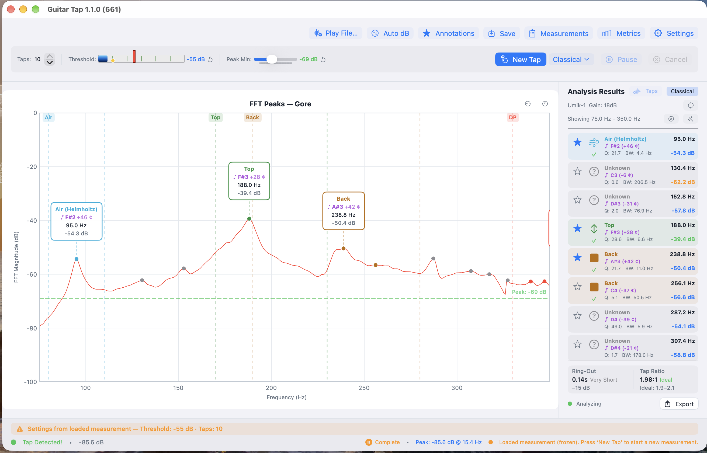

# Chapter 1 — Introduction

## 1.1 What Guitar Tap Does

<!--
SCREENSHOT (single required image for Chapter 1):

  File:   images/ch01-main-analysis-screen.png
  Subject: Guitar Tap on macOS, full window, showing a completed
           guitar-mode measurement. Frozen spectrum with annotated
           peaks visible on the chart; Analysis Results panel open
           on the right showing identified modes and frequencies.
  Notes:  Use a real measurement (not a synthetic test signal) so
          the peak shapes look natural. Window sized so all three
          panes (top controls, chart, results panel) are clearly
          legible. Crop to the window only — no desktop background.
-->

{: .screenshot-desktop }

Guitar Tap captures a tap, runs an FFT, and presents the resulting
spectrum with annotated peaks and a results panel. The app is designed
around the three measurements a luthier following the Gore methodology
(or any similar tap-tone-based workflow) actually takes:

- **Guitar mode** — for a complete instrument body. Single or
  multi-tap averaging; identifies air, top, and back modes plus any
  other significant body resonances above the detection threshold.

- **Plate mode** — for a free plate. Walks you through a longitudinal
  tap, a cross-grain tap, and optionally a diagonal (fLC) tap, with
  a review step between phases so you can accept or redo each one
  before continuing.

- **Brace mode** — for an individual brace. Captures a single
  longitudinal resonance.

In all three modes the tap is captured with onset alignment so the same
physical tap reliably yields the same spectrum, regardless of where in
the FFT frame the impulse happens to land. Measurements can be saved
locally, exported as PDF or spectrum data, and shared as `.guitartap`
files that round-trip between the iOS, macOS, and desktop builds.

## 1.2 What You Need

**Hardware**

- **A device.** Guitar Tap runs on iPhone or iPad (iOS 17 or later),
  Mac (macOS 14 Sonoma or later), and Windows or Linux desktops via the
  Python version of the app.

- **A microphone.** The built-in microphone of an iPhone, iPad, or
  modern Mac is good enough for relative comparisons (one plate against
  another, before and after a thickness change) even if absolute
  values may be slightly off. For repeatable absolute frequencies and
  clean spectra, a calibrated measurement microphone (such as a miniDSP
  UMIK-1) on a USB audio interface is the recommended setup.
  Microphone choice is discussed further in §2.3.

- **A tapping implement.** The recommended implement is a small bouncy
  ball on the end of a stick — it produces a short, clean impulse with
  low operator variability. A firm knuckle rap also works well,
  particularly for guitar-body measurements.

- **A quiet workspace.** A quieter room lets you set a lower detection
  threshold and capture softer taps cleanly.

- **The material to be measured.** A free plate, a brace, or a
  complete instrument.

**Optional**

- **A microphone calibration file** (`.txt` or `.cal`) for your
  measurement microphone. Importing it lets the app correct the
  spectrum for the microphone's frequency response. See §2.4.

## 1.3 How This Manual Is Organised

If you have just installed Guitar Tap and want to take your first
measurement, start with **Chapter 2 — Getting Started**. It covers
installation, microphone permission, audio-input selection, threshold
and peak-min tuning, and a complete first guitar measurement.

If you already know the app and want a focused walk-through of a
particular task — measuring a free plate, multi-tap sequences, export
and share workflows — see the **Guided Use Cases (Chapters 3 through
8)**.

For complete details on a specific control, setting, or shortcut, see
the **Reference chapters (9 through 11)** and the **Appendices**.

A **Glossary** at the end defines the acoustic-analysis terms used
throughout the manual.
