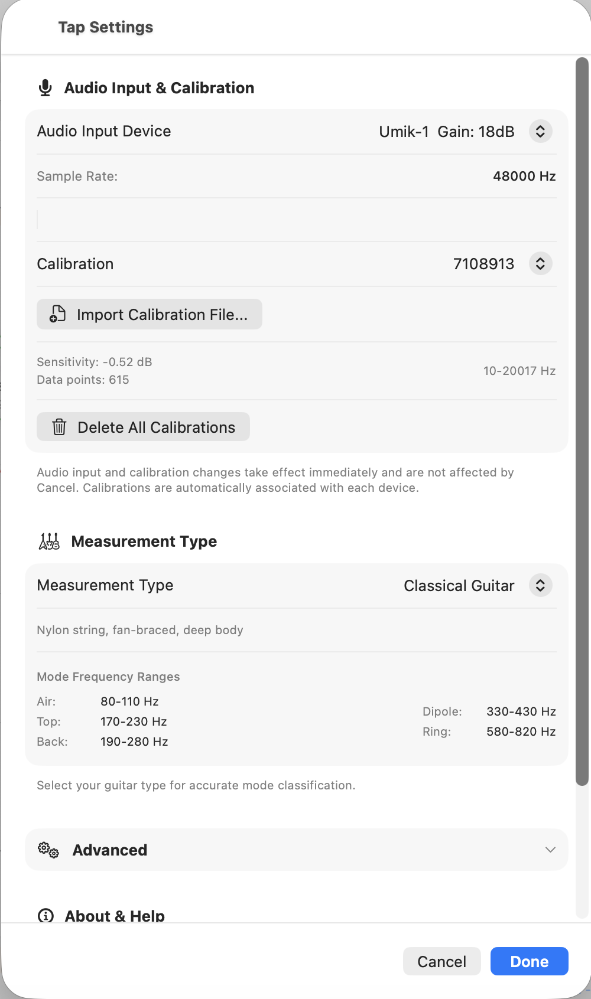
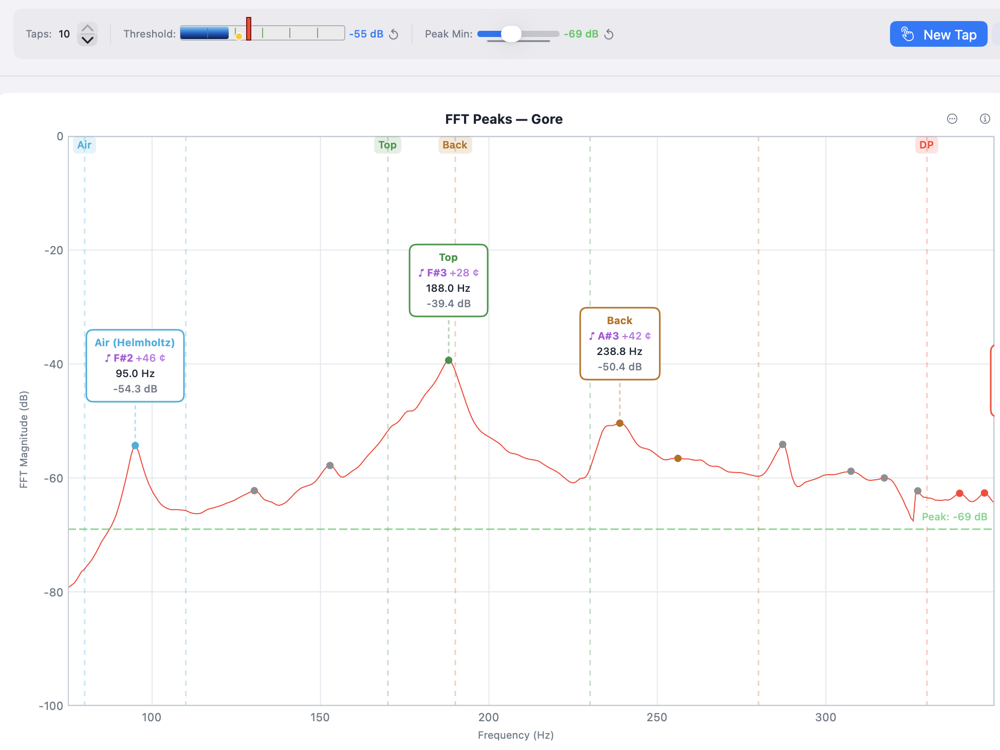

# Chapter 2 — Getting Started

This chapter takes you from a fresh install to your first measurement.
Sections 2.6 and 2.7 cover one-time tuning that any new microphone or
room benefits from; the settings persist so you only do it once.

## 2.1 Installing the App

**iOS / iPadOS.** Search "Guitar Tap" in the App Store and install.

**macOS (native).** Search "Guitar Tap" in the Mac App Store and
install.

**macOS / Windows (Python desktop build).** Run the installer for
your platform from the project release page. The build is bundled
with PyInstaller and ships with its own Python runtime — no separate
Python installation is required.

**Linux (Python desktop build).** Download the AppImage from the
project release page, mark it executable (`chmod +x
GuitarTap-x.y.z.AppImage`), and run it directly. The AppImage
includes everything required; no system packages need to be
installed.

The native and Python builds share the `.guitartap` file format —
measurements written on one can be opened on the other without loss.

## 2.2 Granting Microphone Permission

Guitar Tap cannot operate without microphone access. The grant
procedure differs by platform.

**iOS / iPadOS.** A system dialog appears on first launch. Tap **Allow**.
If you declined, re-enable in **Settings → Guitar Tap → Microphone**.

**macOS.** A system dialog appears on first launch. If you declined,
or already declined for a previous build, open **System Settings →
Privacy & Security → Microphone** and enable Guitar Tap.

**Windows.** Open **Settings → Privacy & Security → Microphone**.
Ensure both "Microphone access" and "Let desktop apps access your
microphone" are on.

**Linux.** PortAudio uses the system's PulseAudio or PipeWire
permissions; there is no in-app dialog. If recording is silent, check
the Recording tab of `pavucontrol` (or your equivalent mixer) while
Guitar Tap is running.

## 2.3 Selecting Your Audio Input

<!--
SCREENSHOT (covers §2.3 and §2.5):

  File:    images/ch02-settings-sheet.png
  Subject: Settings sheet on macOS, showing both the Audio Input
           section (input device list, calibration controls) and
           the Measurement Type section in the same view.
  Notes:   Scroll the sheet (or window-size the app) so both
           sections are simultaneously visible. Show at least one
           USB measurement mic plus a built-in option in the input
           list. Crop to the sheet/window only.
-->

{: .screenshot-panel }

Open Settings (gear icon, top toolbar) and use the **Audio Input**
section to pick your microphone.

- Selecting a device takes effect immediately and persists across
  launches; you do not need to confirm or apply the change.
- The built-in microphone of a modern Mac, iPhone, or iPad is fine
  for relative comparisons.
- A USB measurement microphone (such as a miniDSP UMIK-1) on a USB
  audio interface gives lower noise, flatter response, and supports
  per-device calibration (§2.4).
- The currently selected input is shown in the analysis screen so
  you always know what is being captured.

## 2.4 Importing a Microphone Calibration File

A calibration file corrects the captured spectrum for the
microphone's own frequency response. Without it, the spectrum
includes whatever roll-off and bumps the microphone contributes.

Guitar Tap accepts `.txt` and `.cal` files in the standard
two-column (frequency, dB) format that ships with most measurement
microphones.

To import:

1. In **Settings → Audio Input**, with your measurement microphone
   selected, choose **Import Calibration File** and pick the file.
2. The calibration is bound to that input device. When you switch
   away from it and back again later, the calibration reloads
   automatically.
3. To remove all stored calibrations, use **Clear All Calibrations**
   in the same section.

The status area indicates when a calibration is active for the
current input.

## 2.5 Choosing a Measurement Type

In Settings, the **Measurement Type** section determines what the
analyzer is looking for:

- **Generic Guitar / Acoustic Guitar / Classical Guitar /
  Flamenco Guitar.** Guitar-body mode. The four sub-types differ in
  the expected frequency windows for the air, top, back, and dipole
  modes; pick the one closest to the instrument you are measuring.
  Generic uses the broadest windows.
- **Plate.** Free-plate measurement with the longitudinal,
  cross-grain, and optional free-length-cross phases.
- **Brace.** Single-tap longitudinal measurement on an individual
  brace.

The choice persists across launches. Changing it mid-sequence starts
a new sequence in the new mode.

## 2.6 Setting the Threshold — Finding Your Tap Level

<!--
SCREENSHOT (covers §2.6 and §2.7):

  File:    images/ch02-threshold-peakmin-toolbar.png
  Subject: Main analysis screen on macOS with the toolbar at top
           clearly showing the Threshold slider and Peak Min slider,
           and a live (not frozen) spectrum below with a recent tap
           impulse still visible.
  Notes:   Detection should be paused so the spectrum is live and
           a representative tap peak is visible. Crop to window.
-->

{: .screenshot-strip }

The Threshold slider sets the signal level a tap must exceed before
the analyzer captures it. You will tune it once for your
microphone, room, and tapping style; the value then persists.

The tuning procedure is the same in all three measurement modes:

1. Press **Pause**. The spectrum stays live, but no taps will
   register — you can experiment without triggering a measurement.
2. Make a representative tap and read the highest dB the live
   spectrum reaches.
3. Set Threshold roughly **6 to 10 dB below** that peak level. This
   leaves headroom for tap-to-tap variation while staying clear of
   ambient noise.
4. Press **Resume** and tap again. The spectrum should freeze and
   the **Tap Detected** indicator should appear.

If taps are missed, lower the threshold. If ambient noise triggers
false captures, raise it.

## 2.7 Setting Peak Min — Filtering the Peak List (Guitar Mode)

Peak Min sets the minimum spectrum magnitude at which a peak is
annotated on the chart and considered for guitar-mode analysis. It
is a guitar-mode control: in Plate and Brace modes the per-phase
capture uses its own adaptive noise floor, and Peak Min only
affects which peaks are *drawn* — never which are *selected* for
the calculation.

Tune it from the same paused state used for Threshold:

1. Still paused (continuing from §2.6), make a few representative
   taps and watch the peaks appear on the live spectrum.
2. Raise Peak Min until noise peaks disappear. Lower it until the
   structural resonances you care about are visible.
3. Press **Resume** and take the real measurement.

If you adjust Peak Min on a frozen spectrum after a measurement,
press the **wand** button to re-run automatic mode selection
against the new threshold.

Peak Min persists across launches.

## 2.8 Your First Tap — Guitar Mode Walkthrough

You now have everything you need.

1. Position the microphone 5 to 15 cm from the sound hole. (For
   top- or back-tap measurements, position it 5 to 10 cm from the
   tap point.)
2. The analyzer is already running on launch. Confirm Threshold and
   Peak Min are tuned per §2.6 and §2.7.
3. Press **Resume** if you paused during tuning. The detector is
   armed and the spectrum is live.
4. Tap the guitar — a knuckle rap on the bridge or a bouncy-ball
   strike on the back, depending on what you are measuring. The
   spectrum freezes when the tap registers.
5. Open the **Analysis Results** panel and review the identified
   modes, frequencies, ring-out time, and tap-tone ratio.
6. Press **Save** in the top toolbar to store the measurement so you
   can compare it to future taps.

That is a complete cycle. From here, see the use-case chapters for
the workflow you actually want to run — guitar (Chapter 3), plate
(Chapter 4), or brace (Chapter 5).
