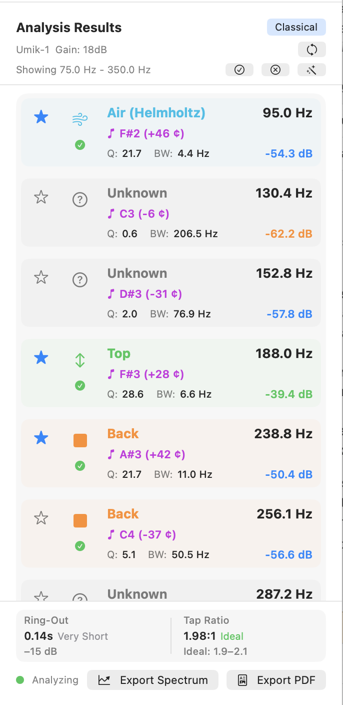
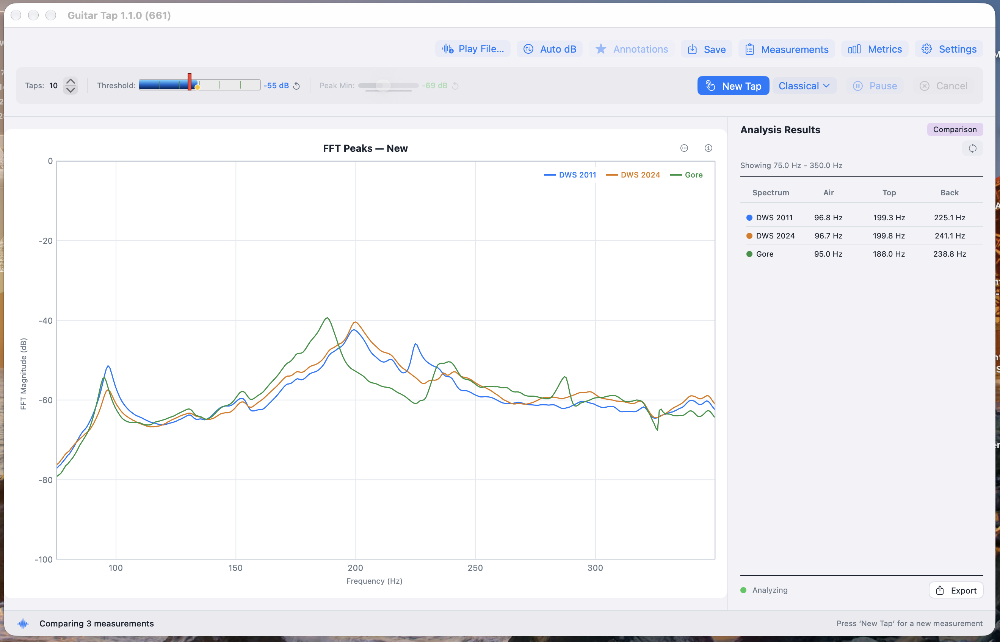

# Chapter 3 — Guitar Mode

Guitar mode captures the body resonances of a completed instrument
and presents them as a labelled peak list. This chapter assumes the
microphone, calibration, threshold, and peak-min are already tuned
as described in Chapter 2.

## 3.1 Mode Labels and Classification

Guitar Tap identifies and labels six classes of guitar-body modes:
**Air**, **Top**, **Back**, **Dipole**, **Ring**, and **Upper Modes**.
Classification is by frequency window: each guitar subtype
(Generic, Acoustic, Classical, Flamenco) defines a range of
frequencies in which a candidate for each mode is expected. The
strongest peak inside a window is assigned to that mode; peaks
outside every window are labelled **Unknown**.

Unknown peaks are shown on the chart by default so nothing in the
spectrum is silently hidden. If you find them cluttering a chart
that you intend to share or compare, turn them off via
**Settings → Advanced → Analysis Settings → Show Unknown Modes**.

**Generic is the recommended subtype for most measurement work.**
Its windows are wide enough to catch the air, top, and back modes
of any of the common guitar archetypes, which is what you want when
you simply need to see and label the resonances of the instrument
in front of you. The other subtypes — Acoustic, Classical, Flamenco
— are narrower and are most useful when:

- you want the **quality indicators** in the Results panel to
  reflect the typical frequency band for that style (the colour
  cues next to each mode and the tap-tone ratio are interpreted
  against the chosen subtype's expectations); or
- you are building or voicing to a **target frequency range**
  associated with a particular style and want the windows to
  exclude peaks that fall outside that target.

The frequency windows can be inspected in Settings → Measurement
Type when a subtype is selected.

## 3.2 Setting Up for Guitar Mode

1. Open **Settings → Measurement Type** and choose **Generic
   Guitar** unless you have a specific reason (quality indicators
   or a target frequency range) to choose Acoustic, Classical, or
   Flamenco — see §3.1.
2. The frequency-window panel updates to show the ranges for the
   selected subtype. Confirm they bracket the modes you expect to
   find.
3. **Show Unknown Modes** is on by default. Leave it on unless you
   are preparing a chart for sharing and want to declutter.
4. Confirm Threshold and Peak Min are tuned for the current mic and
   room (see §2.6 and §2.7).

## 3.3 Microphone Placement

- **Distance:** 5 to 15 cm from the sound hole for body-cavity
  measurements; 5 to 10 cm from the tap point for top or back
  measurements.
- **Angle:** roughly perpendicular to the soundboard or back, but
  not so close that the diaphragm sees only one localized region.
- **Surroundings:** avoid hard surfaces within ~30 cm of the
  microphone. Reflections add spurious peaks and inflate the noise
  floor at the comb frequencies of the workbench geometry.
- **Reproducibility:** mark the mic position (a piece of tape on
  the bench is sufficient) if you intend to compare measurements
  across sessions on the same instrument. Small position changes
  shift the relative magnitudes of modes you may want to track
  build-to-build.

## 3.4 Single Tap Measurement

1. Press **New Tap** to arm the detector. The status area shows
   the analyzer is waiting for a tap.
2. Tap the instrument: a short, crisp knuckle or fingertip rap on
   the bridge, or a bouncy-ball strike on the back.
3. The **Tap Detected** indicator appears and the spectrum freezes
   automatically.
4. Read the annotated peaks on the frozen spectrum and the Analysis
   Results panel (see §3.8 for what each column means).

If the tap was missed or contaminated (a finger squeak, an ambient
transient), press **New Tap** again to discard it and try once
more.

If Threshold or Peak Min need adjusting before the live take,
press **Pause** first — the spectrum stays live and no taps will
register while you experiment. Move the sliders, tap freely, then
press **Resume** when ready.

## 3.5 Multi-Tap Averaging

For tighter results, average several taps in one sequence.

1. Set the **Taps** stepper at the top of the toolbar to the number
   of taps you want (1 to 10). Five is a common choice.
2. Press **New Tap** as before. The status bar now shows progress —
   "Tap 1/5", "Tap 2/5", and so on.
3. Tap the instrument the required number of times. Each captured
   tap re-arms the detector after a short cooldown; the spectrum
   re-freezes only after the final tap.
4. When all taps are captured, the averaged spectrum is displayed
   with annotated peaks. Individual tap spectra are retained for
   comparison.

**The Taps table.** After a multi-tap sequence the Analysis Results
header shows a **Taps** button that switches to a per-tap table: one
row per tap plus an **Averaged** row, with Air / Top / Back columns.
Each per-tap row reports that tap's own detected peak for the mode;
the Averaged row reports the *definitive* peak — the one your
selection and any mode overrides resolve to (§3.6) — so it matches
the peak list and the PDF report. When you have overridden a mode,
the Averaged value is shown in *italics with a trailing asterisk*
(`*`) to flag that it came from your override rather than the
automatic pick. Press Taps again to return to the averaged spectrum.

**Pause between taps.** Press Pause if you need to pause mid-sequence
(to reset the instrument's position, for example). The captured
taps so far are preserved; Resume continues from where you left off.

**Cancel mid-sequence.** Press **Cancel** to restart the sequence — it
discards the captured taps and immediately re-arms for a fresh attempt,
so you can tap again straight away (no need to press New Tap). **New Tap**
itself is only available once a measurement is complete.

Starting a fresh measurement — New Tap, or Cancel-to-restart — begins
from a clean slate: any peak selection, mode overrides, and moved
annotation labels from the previous measurement are cleared.

## 3.6 Inspecting and Adjusting Peak Selections

Each peak in the frozen spectrum is shown with a label (mode name)
and a coloured dot whose colour matches its row in the Analysis
Results panel.

- **Toggle a peak's selection** by tapping its label on the chart.
  Selected peaks contribute to derived values such as the tap-tone
  ratio; deselected peaks remain visible but are excluded from the
  calculation.
- **Cycle the annotation set** using the Annotations button:
  *All* (every detected peak labelled), *Selected* (only currently
  selected peaks), or *None* (no labels on the chart). The default
  is *Selected*, which matches what most luthiers want to see.
- **Re-run automatic selection** by pressing the **wand** button
  in the Analysis Results header. It resets peak *selection* to the
  automatic choice — one peak per single-holder mode, chosen from
  the full peak set — replacing any manual selection you made. Your
  mode-name overrides are kept. The wand does not re-detect or
  re-classify; to rebuild the peak set from a saved measurement's
  stored spectrum, or to re-classify after changing the guitar type,
  use the separate **Re-analyze** button (§9).
- **Select None** clears the selection in one step. There is no
  "Select All": Air, Top, and Back are single-holder modes (below),
  so selecting everything is not a meaningful operation.

**One peak per structural mode.** Air, Top, and Back each resolve to
exactly one *definitive* peak — the selected peak whose mode, after
any override, is that mode. Selecting a second candidate as Top
displaces the first, so the identity is never ambiguous. Dipole,
Ring, and Upper Modes are clusters and may hold several peaks at
once. The definitive peaks are what every derived value (§3.8) and
export is computed from.

Selection changes are preserved when the measurement is saved.

## 3.7 Overriding Mode Classification

The automatic classifier occasionally picks the wrong peak — for
example, when two candidates are close in magnitude and the wrong
one falls inside the configured window. To correct it:

1. In the Analysis Results panel, tap the row of the peak whose
   label you want to change.
2. A mode picker appears with **Air**, **Top**, **Back**,
   **Dipole**, **Ring**, **Upper Modes**, **Unknown**, and a
   **Custom label** field for free-text annotations.
3. Pick the correct mode. The chart label updates immediately.

An overridden mode is shown *in italics with a trailing asterisk*
(`*`) everywhere it appears — the Analysis Results list, the chart
label, and the PDF report — so a manual choice is never mistaken for
the classifier's automatic pick.

Overrides are saved with the measurement and reapplied when the
measurement is loaded later. The wand (§3.6) resets selection but
keeps your mode-name overrides.

**Changing the guitar type clears overrides.** If you change the
guitar type in Settings, Guitar Tap re-classifies the peaks for the
new type, clears your manual mode overrides, and returns selection
to automatic — the identified modes always match the current type.
(A display-only settings change — Peak Min or the display ranges —
leaves peaks, modes, and selection untouched.)

## 3.8 Reading the Results Panel

<!--
SCREENSHOT:

  File:    images/ch03-results-panel.png
  Subject: Close-up of the Analysis Results panel after a completed
           guitar-mode measurement. All columns visible: mode label,
           frequency, magnitude, Q, bandwidth, pitch. Ring-out and
           tap-tone-ratio rows visible below the peak list.
  Notes:   Crop tight to the results panel — no chart. Pick a
           measurement with at least Air, Top, and Back identified
           so the tap-tone ratio reads a sensible value.
-->

{: .screenshot-panel }

For each identified peak the Analysis Results panel shows:

- **Mode label** — Air, Top, Back, Dipole, Ring, Upper, or a custom
  override.
- **Frequency** — in Hz, to 0.1 Hz.
- **Magnitude** — in dB, relative to the spectrum's reference.
- **Q** — quality factor (centre frequency ÷ −3 dB bandwidth).
- **Bandwidth** — −3 dB bandwidth in Hz.
- **Pitch** — nearest equal-temperament note plus cents offset.

Below the peak list:

- **Ring-out** — decay time in seconds, computed from the magnitude
  envelope after the tap impulse. A structural-damping indicator.
- **Tap Tone Ratio** — f_Top ÷ f_Air, computed from the definitive
  (selected, override-aware) Air and Top peaks (§3.6), so the panel,
  the peak list, and the PDF report always agree. Typical values for
  a well-voiced guitar fall in the 1.8–2.4 range; the value is shown
  with a colour cue indicating whether it is in, near, or outside
  that band.

When a value is missing (a mode was not identified, or the ring-out
could not be measured), the panel displays "—" rather than zero so
the absence is unambiguous.

## 3.9 Comparing Guitar Measurements

Comparison overlays two to five saved guitar measurements on the
same chart. Useful for any pair-or-more of measurements you want to
see side by side — different build stages of the same instrument,
different tap locations on the same body, different instruments you
have built, or measurements of instruments built by someone else
that you want to study or learn from.

<!--
SCREENSHOT:

  File:    images/ch03-comparison-overlay.png
  Subject: Comparison mode with three guitar spectra overlaid on a
           single chart. Legend visible identifying each spectrum.
           Comparison Results table visible in the Analysis Results
           panel showing Air / Top / Back rows with colour-coded
           dots for each spectrum.
  Notes:   Choose three measurements with clearly different mode
           frequencies so the overlay is visually informative.
-->

{: .screenshot-desktop }

**Starting a comparison**

1. Open the **Measurements** list.
2. Tap to select two to five saved guitar measurements. Plate and
   brace measurements are excluded — comparison is guitar-only.
3. Tap the **Compare** button that appears once two or more
   measurements are selected.

The chart switches to comparison view: each selected spectrum is
drawn in a distinct colour with a legend. The Analysis Results
panel switches to a comparison table with one column per spectrum
(labelled with the colour dot from the legend) and rows for Air,
Top, and Back frequencies. "—" appears where a mode was not
identified.

**What is available during comparison**

Save, Export Spectrum, and Export PDF Report all remain active, but
they operate on the overlay rather than on an individual
measurement:

- **Save** stores the entire overlay as a single comparison in the
  Measurements list. The save sheet accepts an optional location
  label and notes. The saved comparison appears with a distinct
  badge and can be reloaded later to restore the overlay — every
  spectrum, its colour, and the Comparison Results table — exactly
  as it was. The comparison records which peak carries each mode
  (Air / Top / Back) for every spectrum, including any overrides in
  effect, so the reloaded table and its PDF match the originals;
  comparisons saved by earlier builds gain this information
  automatically when they are opened.
- **Export Spectrum** (⌘E on macOS; Ctrl+E on Windows / Linux)
  writes an overlay PNG with all curves, their colours, and the
  legend.
- **Export PDF Report** (⇧⌘E on macOS; Ctrl+Shift+E on Windows /
  Linux) writes a comparison PDF: a metadata header (number of
  spectra, labels, date), the overlay image, and an Air / Top /
  Back frequency table with one column per spectrum.

A saved comparison `.guitartap` file can be **imported** via
**File → Import Measurement** (macOS / Python desktop) or the
Import Measurement button in the Measurements list (iOS). The app
detects the comparison on load and restores the overlay.

**What is inactive during comparison**

- **Annotations** button — each spectrum carries its own annotations
  set at capture time; there is nothing to cycle in the overlay.
- **Threshold** and **Peak Min** sliders — the comparison view is a
  static overlay of frozen measurements; live detection is not
  running.
- **Taps** stepper — no active capture sequence to configure.

**Exiting comparison.** Press **New Tap** to leave comparison mode
and return to single-measurement operation.
