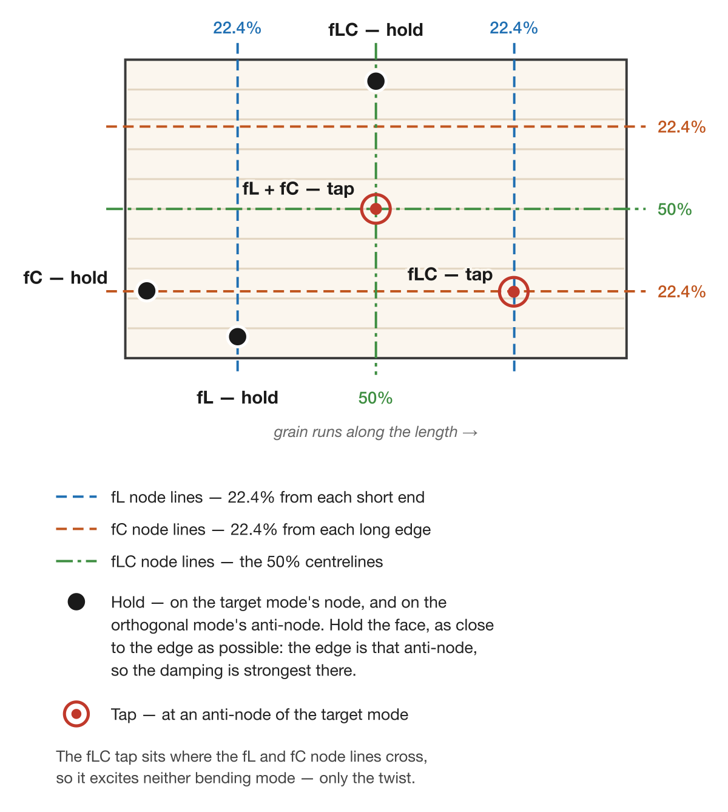

# Chapter 4 — Plate Mode

Plate mode captures the longitudinal, cross-grain, and (optionally)
diagonal resonances of a rectangular tonewood blank and returns the
moduli, specific modulus, radiation ratio, and Gore target thickness
for the piece. This chapter assumes the microphone, calibration,
threshold, and peak-min are already tuned as described in Chapter 2.

## 4.1 Overview of Plate Material Measurements

Plate mode runs a guided sequence of two or three taps on a
rectangular blank suspended at its nodal points and computes the
material properties used to evaluate a piece of tonewood:

- **Longitudinal (fL)** — bending mode with grain. Yields E_L and
  c_L.
- **Cross-grain (fC)** — bending mode across the grain. Yields E_C
  and c_C.
- **Diagonal (fLC)** — torsional mode, optional. Yields the shear
  modulus G_LC, which feeds the Gore target thickness calculation
  and tightens its result by roughly 5 to 7%.

From these the app derives ρ (from your dimensions and mass),
specific modulus E_L/ρ, radiation ratio R, the E_C/E_L
cross-to-long ratio, a quality rating against the spruce scale,
and the Gore target thickness for the body dimensions and
stiffness preset you have selected.

Plate mode is for raw blanks before bracing or cutting. For an
individual brace, use Brace mode (Chapter 5); for a finished body,
use Guitar mode (Chapter 3).

## 4.2 Preparing the Sample

The blank should be a clean rectangle with the grain parallel to
one long axis. The numbers you enter into the app drive every
derived quantity, so accuracy matters:

| Field | Target accuracy |
|---|---|
| Length (along grain) | 0.5 mm |
| Width (cross grain) | 0.5 mm |
| Thickness | 0.1 mm |
| Mass | 0.1 g |

A digital caliper handles the thickness measurement. Length and
width are typically beyond the jaw span of a caliper for
guitar-scale blanks; an accurate steel rule is the better tool
there. A jeweller's scale or any 0.1 g kitchen scale handles
mass.

Mass error dominates. Length and width errors scale linearly into
the moduli; thickness scales as the cube. A 1% mass error and a
0.3% thickness error produce comparable changes in E.

## 4.3 Selecting Plate Mode

<!--
SCREENSHOT:

  File:    images/ch04-settings-plate.png
  Subject: Settings sheet on macOS, Measurement Type set to Plate.
           The sample and body dimension fields are visible (they
           act as the defaults for a new measurement); Plate
           Stiffness preset selector; Measure Diagonal (fLC) Tap
           toggle.
  Notes:   Crop to the settings sheet only.
-->

{: .screenshot-panel }

Open **Settings → Measurement Type → Plate**, and turn on **Measure
Diagonal (fLC) Tap** if you intend to capture the third, diagonal
tap (§4.8) — the sequence then runs in three phases instead of two.

That is all Settings needs before you tap. The Settings sheet also
holds the sample and body dimension fields, but in the current
workflow those act only as the **defaults** for a new measurement.
Filling them in here is optional — it just means a new measurement
starts pre-filled — because the **suggested route is to capture the
taps first and then enter this plate's actual dimensions in the
Analysis Results** (§4.9), where they are editable and drive the
numbers immediately. Entering the dimensions is part of turning the
captured frequencies into results, not a prerequisite for tapping.
The per-measurement dimensions you enter (or edit) in the results
are saved with that measurement; the Settings defaults are left
untouched.

## 4.4 The 22.4% Suspension Technique

The three taps share one principle: hold the blank on a nodal line
of the mode you want to measure, and tap at one of that mode's
antinodes.

For longitudinal and cross-grain there is a catch — **both modes
are easy to excite at the same time**, and the hold point alone
decides which one wins in the spectrum. A hold on a mode's nodal
line suspends that mode (it can vibrate freely); a hold on a
mode's antinode damps it. So the hold must sit **on the target
mode's node *and* on the orthogonal mode's antinode.** That one
combination frees the mode you want and damps the mode you don't,
and it names a specific point rather than a region to avoid.

Hold the **face** of the plate, pinched between thumb and
forefinger just in from the edge. You are not gripping the edge
itself.

How far in is the one judgement call, and the answer is **as close
to the edge as you can manage while still on the face.** The edge
is where the orthogonal mode moves most, so the closer your
fingers sit to it, the harder that mode is damped and the cleaner
the target mode reads. Moving inboard weakens the damping you
want and, past a point, starts loading the target mode as well.

{: .screenshot-desktop }

Three families of lines account for every hold and tap:

- The **longitudinal** mode's nodal lines (blue) run cross-wise,
  22.4% in from each short end.
- The **cross-grain** mode's nodal lines (rust) run length-wise,
  22.4% in from each long edge.
- The **diagonal** mode's nodal lines (green) are the two 50%
  centrelines.

22.4% is the free-free beam node (0.2242 of the length). It is
quoted to that precision because the geometry has a definite
answer, not because a finger can be placed that accurately —
close is good enough.

- **Longitudinal (fL).** Plate oriented with grain horizontal.
  Hold the face on a longitudinal nodal line, as close to a long
  edge as you can: the long edges are the cross-grain mode's
  antinodes, so that single hold frees fL and damps fC. The rest of the plate hangs
  free. Tap the centre of the face.

- **Cross-grain (fC).** Rotate the plate 90° so the grain runs
  vertically. The same logic with the modes swapped — hold the
  face on a cross-grain nodal line, as close to a short end as you
  can, because the short ends are the longitudinal mode's
  antinodes. Tap the centre
  of the face.

- **Diagonal (fLC).** One hand only. Hold the face at the
  **midpoint of one long edge**, which lies on a centreline — the
  torsional mode's node. Tap **22.4% in from the opposite corner
  in both directions.** That point is where the longitudinal and
  cross-grain nodal lines cross, so the tap excites neither
  bending mode and puts its energy into the twist instead.

Common errors: putting the hold on both modes' node lines at once
(contamination — a longitudinal reading that looks like
cross-grain or vice versa); holding too far in along the target
axis (the support falls inside the mode shape and damps it);
holding too firmly (adds damping regardless of position); and
forgetting to rotate the plate between fL and fC — easy to do,
easy to spot when fC reads close to fL.

## 4.5 The Accept / Redo Review Flow

Plate mode runs each phase as: arm, tap, freeze, review.

After a tap is captured the spectrum freezes and the detector
pauses automatically. The tap controls re-label for the review
state:

- The **Pause** button becomes **Accept** (green tint, checkmark
  icon). Pressing it locks in the current phase result and advances
  to the next phase. The next phase arms detection on its own — you
  do not need to press New Tap between phases.
- The **Cancel** button becomes **Redo** (orange, labelled
  **Redo fL**, **Redo fC**, or **Redo fLC** depending on which
  phase is being reviewed). Pressing it discards the current phase
  result and re-arms detection for the same phase.

During review the live spectrum is suppressed so the captured
spectrum stays on screen for inspection. The instruction card below
the chart names the current phase — for example **Step 2:
Cross-grain (fC) Mode** — with a **Phase 2/3** indicator.

After every phase is accepted the Results panel updates with the
complete plate calculations (§4.9).

Individual phase redo is only available **before** that phase is
accepted. To restart the entire sequence — for example, you realise
mid-sequence that the longitudinal tap was contaminated — press
**New Tap**; the captured phases are discarded and the sequence
starts again from the Longitudinal (fL) tap.

## 4.6 Tap 1 — Longitudinal

1. Orient the plate with the **grain running horizontally**.
2. Hold the face on a longitudinal nodal line — 22.4% in from one
   short end — as close to a long edge as you can (§4.4).
3. Press **New Tap**. The instruction card below the chart shows
   **Step 1: Longitudinal (fL) Mode** with a **Phase 1/2** indicator
   (or **Phase 1/3** if Measure Diagonal (fLC) Tap is on).
4. Tap the centre of the plate face.
5. The spectrum freezes. Inspect the lowest peak — it should be
   the longitudinal bending mode for a free-free beam of your
   dimensions, typically in the low hundreds of Hz for a guitar
   top.
6. Press **Accept** to lock the phase in, or **Redo fL** to
   re-capture if the tap was contaminated.

After Accept the sequence advances to Cross-grain automatically.

## 4.7 Tap 2 — Cross-Grain

1. **Rotate the plate 90°** so the grain now runs vertically.
2. Hold the face on a cross-grain nodal line — 22.4% in from one
   long edge — as close to a short end as you can (§4.4).
3. The card now shows **Step 2: Cross-grain (fC) Mode**,
   **Phase 2/2** (or **Phase 2/3**). Detection is already armed —
   do not press New Tap.
4. Tap the centre of the plate face.
5. Inspect the frozen spectrum, then **Accept** or **Redo fC**.

After Accept, the sequence either advances to the Diagonal (fLC)
tap (if Measure Diagonal (fLC) Tap is on) or marks the measurement
complete.

## 4.8 Tap 3 — Diagonal (Optional)

The Diagonal (fLC) tap measures the flat long/cross torsional mode
and yields the shear modulus G_LC. The Gore target thickness
calculation uses G_LC for its shear correction; without it, the
calculation substitutes a default that over-estimates target
thickness by roughly 5 to 7%. For final plate thicknessing,
capturing the Diagonal tap is worth the extra tap.

1. Enable Measure Diagonal (fLC) Tap in Settings before starting
   the sequence if you have not already.
2. Hold the face at the **midpoint of one long edge**, with one
   hand only.
3. The card shows **Step 3: Diagonal (fLC) Mode**, **Phase 3/3**.
4. Tap **22.4% in from the opposite corner in both directions** —
   where the longitudinal and cross-grain nodal lines cross.
5. **Accept** or **Redo fLC**.

After Accept the measurement is complete and the Results panel
updates with Gore target thickness including the shear correction.

## 4.9 Analyzing Plate Results

<!--
SCREENSHOT:

  File:    images/ch04-results-panel.png
  Subject: Plate measurement Results panel scrolled to show its
           sections: Detected Peaks, the editable Sample Dimensions
           and Body Dimensions blocks, Gore Target Thickness, Plate
           Properties, and Plate Process Instructions. Captured from
           a completed three-phase sequence (Diagonal tap enabled)
           so the shear-modulus row is populated and the Gore
           Target Thickness does not show the assumed-0 note.
  Notes:   Use a real measurement so the numbers are plausible.
           Crop to the panel only.
-->

{: .screenshot-panel }

Once the taps are captured, the Results panel is where you turn
those frequencies into material properties. The captured
frequencies are fixed; you enter this plate's **sample and body
dimensions** here, and every derived number recomputes live as you
type. The dimension fields seed from the Settings defaults at the
moment the measurement completes, so a plate you set up ahead of
time already reads correctly — but the panel is the place to enter
or correct the actual measured values for this piece. The panel
scrolls through the sections below, top to bottom.

### Detected Peaks

One row per captured phase — two rows (fL, fC) for a two-tap
sequence, three rows (fL, fC, fLC) when the Diagonal tap is
enabled. Each row shows a selection-indicator star, the peak
frequency, the peak magnitude in dB, and a coloured phase badge
identifying which mode the peak belongs to (blue fL, orange fC,
purple fLC). The full detected-peak list and the Peak Min filter
from guitar mode do not apply here; what you see is the
auto-selected best peak from each phase capture.

### Sample Dimensions

The four measured dimensions of the blank, each **editable in
place**:

- **Length** (mm) — along the grain.
- **Width** (mm) — across the grain.
- **Thickness** (mm).
- **Mass** (g).

A live **Calculated Density** is shown with them — use it as a
sanity check on data entry. Spruce typically lands in the
0.35–0.45 g/cm³ band; a value below 0.30 or above 0.70 is almost
always a transposed digit or a unit error somewhere in the four
fields. Editing any field recomputes the density and every
property below immediately.

### Body Dimensions

The finished-instrument parameters that feed the Gore target
thickness (plate only), also editable in place:

- **Body Length (a)** (mm) and **Lower Bout Width (b)** (mm) — the
  dimensions of the instrument the plate is destined for.
- **Panel Stiffness** — the target stiffness number (f_vs) the Gore
  thickness calculation solves for. The named presets are starting
  points calibrated to typical instrument styles:
    - **Steel String Top** (75)
    - **Steel String Back** (55)
    - **Classical Top** (60)
    - **Classical Back** (50)
    - **Custom** — accepts any numeric target.

  **Custom** is where you encode a successful build back into the
  calculation. The workflow has four steps:

  1. Fully measure a plate — E_L, E_C, density, body dimensions
     — *before* you build it, and keep the measurements. Note
     the final plate thickness you settled on for the build
     (which may be the number from the Gore formula).
  2. Build the instrument and live with it long enough to decide
     whether the result is what you want. If it is, you have a
     calibration point. If not, you need to adjust the panel
     stiffness on your next build to either stiffen the board or
     loosen it to adjust the sound.
  3. The Gore formula run on that plate's measurements with a
     named preset would have predicted some recommended
     thickness. Your finished thickness is the thickness that
     actually produced the sound you liked. Scale the preset's
     stiffness number linearly so the formula, applied to that
     same plate's measurements, would output your finished
     thickness. Save the scaled number as your **Custom** value.
  4. From this point on, run new plates with **Custom** selected.
     Each new board, with its own E_L, E_C, and ρ, yields a
     *different* recommended thickness — each one calculated to
     reproduce the calibration build's tonal outcome on that
     specific piece of wood.

  The Custom number carries "this is the kind of plate that makes
  the instrument I want." The Gore procedure does not predict an
  objectively ideal thickness; it gives you a reproducible way to
  translate a tonal target across pieces of wood that differ in
  stiffness and density.

### Gore Target Thickness

The headline recommended thickness in mm, computed from the sample
and body dimensions above and the captured frequencies. When the
**Diagonal (fLC)** tap was skipped, the shear modulus G_LC is
assumed 0 and the thickness is approximate (roughly 5 to 7%
over-estimate; see §4.8) — enable **Measure Diagonal (fLC) Tap**
for a more accurate result.

### Plate Properties

Material characterisation of the wood:

- **Speed of Sound** — c_L and c_C in m/s.
- **Young's Modulus (E)** — E_L and E_C in GPa. **GLC (Shear)** is
  reported among these moduli when the Diagonal tap was measured;
  the row is absent when it was skipped.
- **Specific Modulus (E/ρ)** — the headline material number, in
  GPa/(g/cm³). Shown in large type for both Longitudinal and
  Cross-grain, each with a per-direction quality rating
  (Excellent / Very Good / Good / Fair / Poor against the spruce
  scale) and a colour cue matching that rating.
- **Radiation Ratio (R)** — reported for both directions.
- **Cross/Long Ratio** — E_C / E_L. Typical spruce 0.04 to 0.08;
  the typical band is shown beside the value.
- **Long/Cross Ratio** — the reciprocal. Typical spruce 12 to 25;
  the typical band is shown beside the value.
- **Overall Quality** — a separate row at the bottom of the
  section combining both directions into a single rating
  (Excellent / Very Good / Good / Fair / Poor) with the matching
  colour cue.

The frequencies themselves (fL, fC, fLC) are inputs and are shown
in the Detected Peaks table above, not repeated here. The quality
scales are calibrated for spruce; readings on cedar, redwood, or
other top woods read as a point of comparison rather than an
absolute grade.

### Plate Process Instructions

A reference card describing the two-tap (or three-tap, if the
Diagonal tap is enabled) measurement procedure. Useful as an
in-place refresher when you come back to plate mode after a break
and want the hold and tap positions without leaving the results
panel.

## 4.10 Interpreting Plate Results

Specific modulus and radiation ratio capture what Young's modulus
alone misses: how stiff a plate is **per unit of weight it is
asking the player to drive**. Two blanks with identical E_L can
sit in very different quality bands when their densities differ.
Sort by E_L/ρ, not E_L, when triaging a stack of blanks.

Gore target thickness is a starting point for thicknessing, not a
specification. Reproduce it on the bench, then voice from there
with hands-on tap-tone evaluation; the final number lives at the
intersection of your wood, your bracing pattern, and the
instrument design you are building toward.

For tracking measurements across multiple blanks: enter a brief
identifier (board number, supplier, billet) into the Notes field
on the Save sheet so the saved measurement carries its
provenance.
Plate measurements can be saved, reloaded, and exported the same
way guitar measurements can (Chapter 7); the comparison overlay
described in §3.9 is guitar-only.
