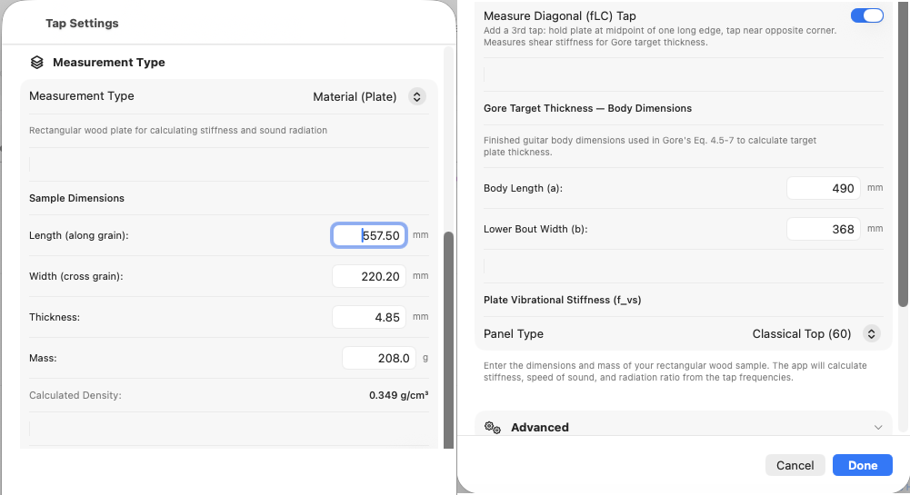
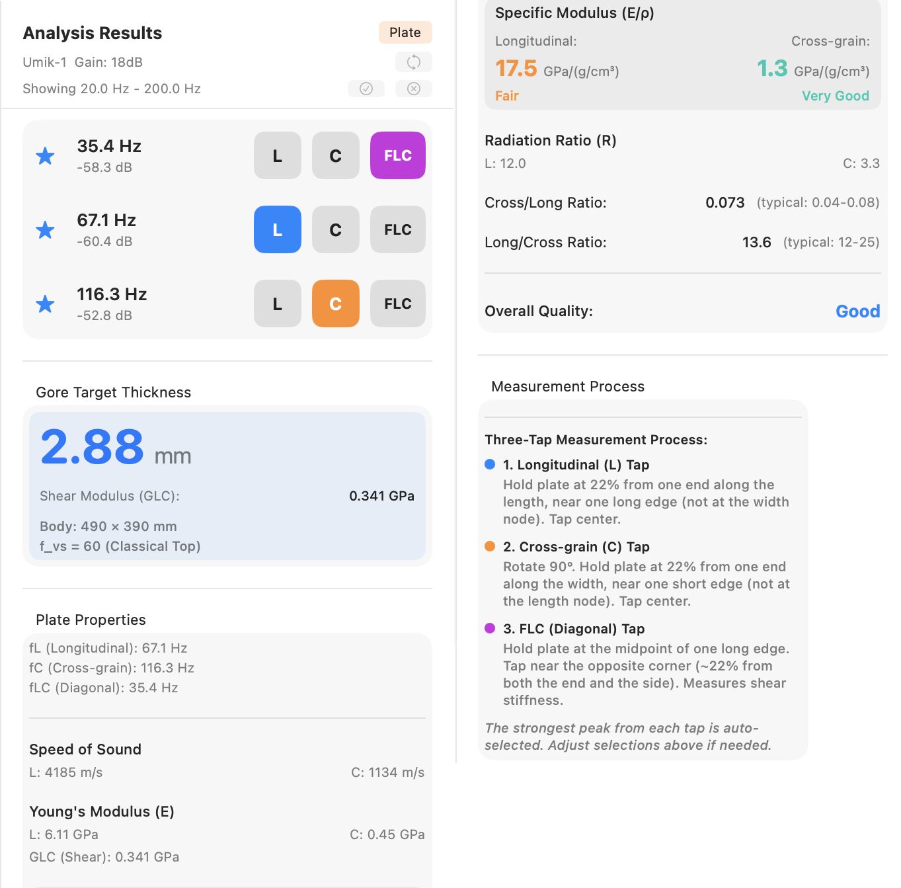

# Chapter 4 — Plate Mode

Plate mode captures the longitudinal, cross-grain, and (optionally)
free-length-cross resonances of a rectangular tonewood blank and
returns the moduli, specific modulus, radiation ratio, and Gore
target thickness for the piece. This chapter assumes the
microphone, calibration, threshold, and peak-min are already tuned
as described in Chapter 2.

## 4.1 Overview of Plate Material Measurements

Plate mode runs a guided sequence of two or three taps on a
rectangular blank suspended at its nodal points and computes the
material properties used to evaluate a piece of tonewood:

- **Longitudinal (L)** — bending mode with grain. Yields E_L and
  c_L.
- **Cross-grain (C)** — bending mode across the grain. Yields E_C
  and c_C.
- **Free-length-cross (FLC)** — torsional mode, optional. Yields
  the shear modulus G_LC, which feeds the Gore target thickness
  calculation and tightens its result by roughly 5 to 7%.

From these the app derives ρ (from your dimensions and mass),
specific modulus E_L/ρ, radiation ratio R, the E_C/E_L
cross-to-long ratio, a quality rating against the spruce scale,
and the Gore target thickness for the body dimensions and
stiffness preset you have selected.

Plate mode is for raw blanks before bracing or cutting. For an
individual brace, use Brace mode (Chapter 5); for a finished body,
use Guitar mode (Chapter 3).

## 4.2 Preparing the Sample

The blank should be a clean rectangle with the grain parallel to
one long axis. The numbers you enter into the app drive every
derived quantity, so accuracy matters:

| Field | Target accuracy |
|---|---|
| Length (along grain) | 0.5 mm |
| Width (cross grain) | 0.5 mm |
| Thickness | 0.1 mm |
| Mass | 0.1 g |

A digital caliper handles the thickness measurement. Length and
width are typically beyond the jaw span of a caliper for
guitar-scale blanks; an accurate steel rule is the better tool
there. A jeweller's scale or any 0.1 g kitchen scale handles
mass.

Mass error dominates. Length and width errors scale linearly into
the moduli; thickness scales as the cube. A 1% mass error and a
0.3% thickness error produce comparable changes in E.

## 4.3 Entering Dimensions in Settings

<!--
SCREENSHOT:

  File:    images/ch04-settings-plate.png
  Subject: Settings sheet on macOS, Measurement Type set to Plate.
           All input fields visible: Length, Width, Thickness, Mass
           with their entered values; live density preview line
           below them; Body Length and Lower Bout Width fields for
           the Gore thickness calculation; Plate Stiffness preset
           selector with the four options; Measure FLC toggle.
  Notes:   Use plausible spruce-top numbers (e.g. 540 x 220 x 4 mm,
           50 g) so the density preview reads ~0.42 g/cm³. Crop to
           the settings sheet only.
-->

{: .screenshot-panel }

Open **Settings → Measurement Type → Plate**. Fill in:

- **Length** (mm) — along the grain.
- **Width** (mm) — across the grain.
- **Thickness** (mm).
- **Mass** (g).

A live **density preview** appears below the dimension fields. Use
it as a sanity check on data entry. Spruce typically lands in the
0.35–0.45 g/cm³ band; a value below 0.30 or above 0.70 is almost
always a transposed digit or a unit error somewhere in the four
fields.

For the Gore target thickness, also enter:

- **Body Length** (mm) and **Lower Bout Width** (mm) — the
  dimensions of the instrument the plate is destined for.
- **Plate Stiffness Preset** — the target stiffness number the Gore
  thickness calculation solves for. The named presets are starting
  points calibrated to typical instrument styles:
    - **Steel String Top** (75)
    - **Steel String Back** (55)
    - **Classical** (50)
    - **Custom** — accepts any numeric target.

  **Custom** is where you encode a successful build back into the
  calculation. The workflow has four steps:

  1. Fully measure a plate — E_L, E_C, density, body dimensions
     — *before* you build it, and keep the measurements. Note
     the final plate thickness you settled on for the build
     (which may be the number from the Gore formula).
  2. Build the instrument and live with it long enough to decide
     whether the result is what you want. If it is, you have a
     calibration point. If not, you need to adjust the plate
     stiffness preset on your next build to either stiffen the
     board or loosen it to adjust the sound.
  3. The Gore formula run on that plate's measurements with a
     named preset would have predicted some recommended
     thickness. Your finished thickness is the thickness that
     actually produced the sound you liked. Scale the preset's
     stiffness number linearly so the formula, applied to that
     same plate's measurements, would output your finished
     thickness. Save the scaled number as your **Custom** value.
  4. From this point on, run new plates with **Custom** selected.
     Each new board, with its own E_L, E_C, and ρ, yields a
     *different* recommended thickness — each one calculated to
     reproduce the calibration build's tonal outcome on that
     specific piece of wood.

  The Custom number carries "this is the kind of plate that makes
  the instrument I want." The Gore procedure does not predict an
  objectively ideal thickness; it gives you a reproducible way to
  translate a tonal target across pieces of wood that differ in
  stiffness and density.

**Measure FLC** is a toggle in the same section. Turn it on if you
intend to capture the FLC tap (§4.8). The sequence then runs in
three phases instead of two.

## 4.4 The 22% Suspension Technique

The three taps share one principle: hold the blank at a nodal
point of the mode you want to measure, and tap at an antinode.

For longitudinal and cross-grain there is a catch — **both modes
are easy to excite at the same time**, and the hold point alone
decides which one wins in the spectrum. A hold on a mode's nodal
line suspends that mode (it can vibrate freely); a hold on a
mode's antinode damps it. To get a clean reading the hold must
sit **on the target mode's node *and* off the orthogonal mode's
node.**

In all three orientations the **tap point is the centre of the
plate face**.

- **Longitudinal.** Plate oriented with grain horizontal.
    - The longitudinal mode's nodal line runs cross-wise at 22%
      from each short end.
    - The cross-grain mode's nodal lines run length-wise at 22%
      from each long edge.
    - Hold between thumb and forefinger **22% in from one short
      end along the length, close to one long edge but not at 22%
      in from it.** The other end of the plate hangs free; tap at
      the centre.

- **Cross-grain.** Rotate the plate 90° so grain is now vertical.
  Same logic with the modes swapped: now the cross-grain mode's
  node is the one you want to be on, and the longitudinal mode's
  node is the one to avoid.
    - Hold **22% in from one long edge, close to one short end but
      not at 22% in from it.** Other end hangs free.

- **FLC.** One hand only. Hold at the **midpoint of one long
  edge**. Tap near the **opposite corner**, approximately 22% in
  from both the end and the side. The torsional mode FLC excites
  has its node along the centreline of the plate, so a single
  midpoint hold is enough.

Common errors: putting the hold on both modes' node lines at once
(contamination — a longitudinal reading that looks like
cross-grain or vice versa); holding too far in along the target
axis (the support falls inside the mode shape and damps it);
holding too firmly (adds damping regardless of position); and
forgetting to rotate the plate between L and C — easy to do, easy
to spot when C reads close to L.

<!--
Diagrams of the three hold positions appear in the outline but
are intentionally omitted from this chapter: the audience is
expected to know what 22% from the ends of a free-free beam
means, and the textual orientation conventions above are
unambiguous.
-->

## 4.5 The Accept / Redo Review Flow

Plate mode runs each phase as: arm, tap, freeze, review.

After a tap is captured the spectrum freezes and the detector
pauses automatically. The tap controls re-label for the review
state:

- The **Pause** button becomes **Accept** (green tint, checkmark
  icon). Pressing it locks in the current phase result and advances
  to the next phase. The next phase arms detection on its own — you
  do not need to press New Tap between phases.
- The **Cancel** button becomes **Redo** (orange, labelled
  **Redo L**, **Redo C**, or **Redo FLC** depending on which phase
  is being reviewed). Pressing it discards the current phase
  result and re-arms detection for the same phase.

During review the live spectrum is suppressed so the captured
spectrum stays on screen for inspection. The status bar shows the
current phase and tap count: **Phase 2/3 · Tap 1/1**, for example.

After every phase is accepted the Results panel updates with the
complete plate calculations (§4.9).

Individual phase redo is only available **before** that phase is
accepted. To restart the entire sequence — for example, you realise
mid-FLC that the longitudinal tap was made before you'd entered
the right dimensions — press **New Tap**; the captured phases are
discarded and the sequence starts again from Longitudinal.

## 4.6 Tap 1 — Longitudinal

1. Orient the plate with the **grain running horizontally**.
2. Hold at 22% from each end along the length, near one long edge.
3. Press **New Tap**. The status bar shows
   **Capturing Longitudinal · Phase 1/2** (or **Phase 1/3** if
   Measure FLC is on).
4. Tap the centre of the plate face.
5. The spectrum freezes. Inspect the lowest peak — it should be
   the longitudinal bending mode for a free-free beam of your
   dimensions, typically in the low hundreds of Hz for a guitar
   top.
6. Press **Accept** to lock the phase in, or **Redo L** to
   re-capture if the tap was contaminated.

After Accept the sequence advances to Cross-grain automatically.

## 4.7 Tap 2 — Cross-Grain

1. **Rotate the plate 90°** so the grain now runs vertically.
2. Hold at 22% from each end along the width, near one short edge.
3. The status bar now reads **Capturing Cross-grain · Phase 2/2**
   (or **Phase 2/3**). Detection is already armed — do not press
   New Tap.
4. Tap the centre of the plate face.
5. Inspect the frozen spectrum, then **Accept** or **Redo C**.

After Accept, the sequence either advances to FLC (if Measure FLC
is on) or marks the measurement complete.

## 4.8 Tap 3 — FLC (Optional)

FLC measures the flat long/cross torsional mode and yields the
shear modulus G_LC. The Gore target thickness calculation uses
G_LC for its shear correction; without it, the calculation
substitutes a default that over-estimates target thickness by
roughly 5 to 7%. For final plate thicknessing, capturing FLC is
worth the extra tap.

1. Enable Measure FLC in Settings before starting the sequence
   if you have not already.
2. Hold one long edge at its **midpoint**, with one hand only.
3. The status bar reads **Capturing FLC · Phase 3/3**.
4. Tap near the **opposite corner**, approximately 22% in from
   the end and 22% in from the side.
5. **Accept** or **Redo FLC**.

After Accept the measurement is complete and the Results panel
updates with Gore target thickness including the shear correction.

## 4.9 Reading Plate Results

<!--
SCREENSHOT:

  File:    images/ch04-results-panel.png
  Subject: Plate measurement Results panel scrolled to show all
           four sections: Detected Peaks, Gore Target Thickness,
           Plate Properties, Plate Process Instructions. Captured
           from a completed three-phase sequence (FLC enabled) so
           shear-modulus rows are populated and the Gore Target
           Thickness section does not show the GLC-assumed-0 note.
  Notes:   Use a real measurement so the numbers are plausible.
           Crop to the panel only.
-->

{: .screenshot-panel }

For a completed plate measurement the Results panel scrolls
through four sections, top to bottom.

### Detected Peaks

One row per captured phase — two rows (L, C) for a two-tap
sequence, three rows (L, C, FLC) when FLC is enabled. Each row
shows a selection-indicator star, the peak frequency, the peak
magnitude in dB, and a coloured phase badge identifying which
mode the peak belongs to (blue L, orange C, purple FLC). The full
detected-peak list and the Peak Min filter from guitar mode do
not apply here; what you see is the auto-selected best peak from
each phase capture.

### Gore Target Thickness

The headline thickness for the body dimensions and stiffness
preset entered in Settings, displayed prominently in mm. Below the
number:

- **Shear Modulus (G_LC)** — the value used in the thickness
  calculation, shown when FLC was measured.
- **"G_LC assumed 0 — enable FLC tap for a more accurate result"**
  — shown when FLC was skipped. The thickness above is then
  approximate (roughly 5 to 7% over-estimate; see §4.8).
- **Body dimensions** and the **f_vs** value (with preset name, or
  a literal "custom" annotation when Custom is active) — the
  parameters that fed the calculation, exposed so you can
  cross-check Settings against the body the plate is destined for.

### Plate Properties

Material characterisation of the wood:

- **Frequencies used** — fL, fC, and (if measured) fLC.
- **Speed of Sound** — c_L and c_C in m/s.
- **Young's Modulus (E)** — E_L and E_C in GPa. **G_LC** is
  appended to this block when FLC was measured; the row is absent
  when FLC was skipped.
- **Specific Modulus (E/ρ)** — the headline material number, in
  GPa/(g/cm³). Shown in large type for both Longitudinal and
  Cross-grain, each with a per-direction quality rating
  (Excellent / Very Good / Good / Fair / Poor against the spruce
  scale) and a colour cue matching that rating.
- **Radiation Ratio (R)** — reported for both directions.
- **Cross/Long Ratio** — E_C / E_L. Typical spruce 0.04 to 0.08;
  the typical band is shown beside the value.
- **Long/Cross Ratio** — the reciprocal. Typical spruce 12 to 25;
  the typical band is shown beside the value.
- **Overall Quality** — a separate row at the bottom of the
  section combining both directions into a single rating
  (Excellent / Very Good / Good / Fair / Poor) with the matching
  colour cue.

The quality scales are calibrated for spruce; readings on cedar,
redwood, or other top woods read as a point of comparison rather
than an absolute grade.

### Plate Process Instructions

A reference card describing the two-tap (or three-tap, if FLC is
enabled) measurement procedure. Useful as an in-place refresher
when you come back to plate mode after a break and want the hold
and tap positions without leaving the results panel.

## 4.10 Interpreting Plate Results

Specific modulus and radiation ratio capture what Young's modulus
alone misses: how stiff a plate is **per unit of weight it is
asking the player to drive**. Two blanks with identical E_L can
sit in very different quality bands when their densities differ.
Sort by E_L/ρ, not E_L, when triaging a stack of blanks.

Gore target thickness is a starting point for thicknessing, not a
specification. Reproduce it on the bench, then voice from there
with hands-on tap-tone evaluation; the final number lives at the
intersection of your wood, your bracing pattern, and the
instrument design you are building toward.

For tracking measurements across multiple blanks: enter a brief
identifier (board number, supplier, billet) into the Notes field
on the Save sheet so the saved measurement carries its
provenance.
Plate measurements can be saved, reloaded, and exported the same
way guitar measurements can (Chapter 7); the comparison overlay
described in §3.9 is guitar-only.
