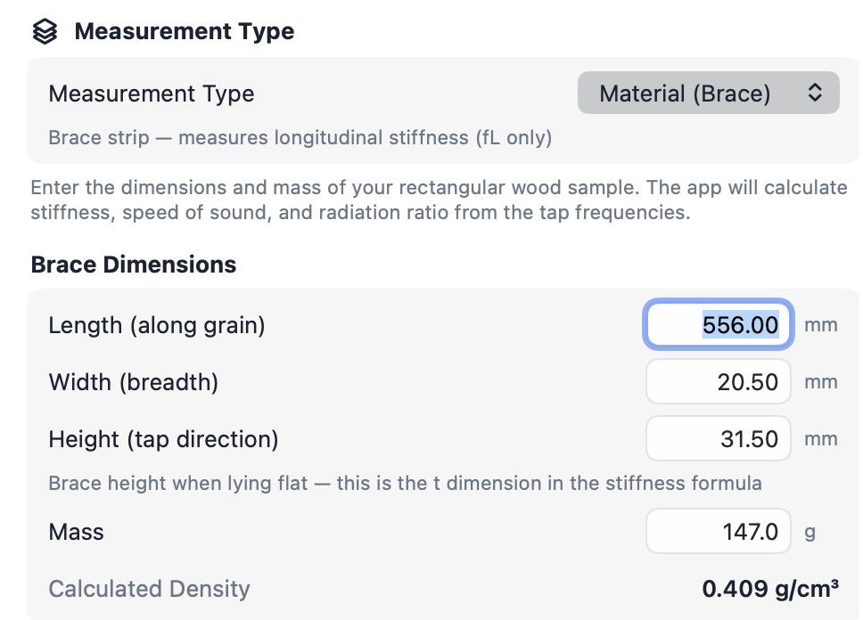
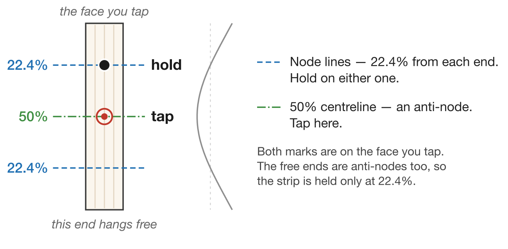
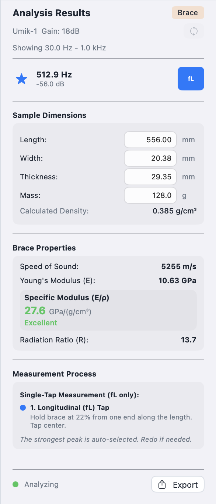

# Chapter 5 — Brace Mode

Brace mode is a fast, single-tap longitudinal measurement for an
individual brace strip. It reports the moduli, specific modulus,
and quality rating in one capture; cross-grain, shear, and Gore
thickness are all skipped. This chapter assumes the microphone,
calibration, threshold, and peak-min are already tuned as in
Chapter 2.

## 5.1 Overview

Brace mode runs a single longitudinal tap on a brace strip and
returns the wood's stiffness and quality. Compared to Plate mode:

- **No cross-grain tap.** E_C is not measured.
- **No Diagonal (fLC) tap.** G_LC is not measured.
- **No Cross/Long ratio.**
- **No Gore target thickness.** Brace mode is for stock evaluation,
  not for thicknessing.

What you get: E_L, c_L, specific modulus E_L/ρ with a per-direction
quality rating against the spruce scale, and radiation ratio R.

Brace mode is intended for batch-evaluating brace strips before
selecting stock for a build. For a free plate, use Plate mode
(Chapter 4); for a complete instrument, use Guitar mode (Chapter 3).

## 5.2 Selecting Brace Mode

<!--
SCREENSHOT:

  File:    images/ch05-settings-brace.png
  Subject: Settings sheet on macOS, Measurement Type set to Brace.
           The brace dimension fields (Length, Width, Height, Mass)
           are visible as the defaults for a new measurement.
  Notes:   Crop to the settings sheet.
-->

{: .screenshot-panel-small }

Open **Settings → Measurement Type → Brace**. That is all Settings
needs before you tap. As in plate mode, the Settings sheet holds
the brace dimension fields, but in the current workflow those act
only as the **defaults** for a new measurement. The suggested route
is to capture the tap first and then enter this strip's actual
dimensions in the Analysis Results (§5.4), where they are editable
and drive the numbers immediately. Filling them in ahead of time in
Settings is optional — it just means a new measurement starts
pre-filled; the per-measurement dimensions you enter in the results
are what's saved with that measurement, and the Settings defaults
are left untouched.

## 5.3 Technique

A brace strip is a long thin beam — the same free-free fundamental
applies, but the measurement is much simpler than plate because
only one mode is in play. With no orthogonal mode to suppress,
there is nothing to trade off: hold on a nodal line, tap the
centre.

{: .diagram-wide }

The curve alongside the strip is the first free-free bending mode.
It crosses zero exactly at the two nodal lines, which is where the
22.4% figure comes from — and the hold is a pinch through the
thickness at that line, so both marks land on the face you tap.

1. Hold the strip between thumb and forefinger **22.4% in from one
   end along the length** — pinch the face you intend to tap and
   the face opposite it. The other end hangs free.
2. Lay the strip flat (or mount it however you usually orient it
   on the bench) so the face you intend to tap is exposed. The
   `Height` value in Settings must match the dimension
   perpendicular to this face.
3. Press **New Tap**.
4. Tap the centre of the top face. The spectrum freezes when the
   tap registers.

The **Accept** / **Redo** review flow is the same as in Plate mode
(see §4.5). Accept locks in the measurement; Redo discards it and
re-arms the detector. There is no phase counter — Brace mode runs
in a single phase, so the status bar shows just the current state.

## 5.4 Analyzing Brace Results

<!--
SCREENSHOT:

  File:    images/ch05-results-panel.png
  Subject: Brace measurement Results panel scrolled to show its
           sections: Selected Peaks (the single fL row with star +
           frequency + magnitude + fL phase badge), the editable
           Sample Dimensions block (Length, Width, Height, Mass +
           calculated density), Brace Properties (Speed of Sound,
           Young's Modulus, Specific Modulus in large type with
           quality colour, Radiation Ratio), and Brace Process
           Instructions.
  Notes:   Use a real measurement so the numbers are plausible;
           pick a strip whose specific modulus lands in one of
           the named rating bands so the colour cue is visible.
           Crop to the panel only.
-->

{: .screenshot-panel-tall }

Once the tap is captured, the Results panel is where you turn the
frequency into material properties: you enter this strip's
dimensions and the properties recompute live as you type. The
dimension fields seed from the Settings defaults at the moment the
measurement completes. The panel shows the sections below.

### Selected Peaks

A single row for the longitudinal peak. It shows a
selection-indicator star, the peak frequency, the peak magnitude
in dB, and a blue **fL** phase badge.

### Sample Dimensions

The strip's dimensions, each **editable in place**:

- **Length** (mm) — the long axis of the strip, along the grain.
- **Width** (mm) — the brace's breadth lying flat.
- **Thickness** (mm) — for a brace this is the dimension
  perpendicular to the face you tap (the same value Settings labels
  **Height (tap direction)**). It is the `t` in the Euler–Bernoulli
  stiffness formula, so it drives E_L most strongly; double-check it
  before trusting the result.
- **Mass** (g).

A live **Calculated Density** is shown with them. Use it the same
way as in plate mode — spruce should land in the 0.35–0.45 g/cm³
range, and a value well outside that is almost always a digit
transposition. Editing any field recomputes every property below
immediately.

### Brace Properties

- **Speed of Sound** — c_L in m/s.
- **Young's Modulus (E)** — in GPa.
- **Specific Modulus (E/ρ)** — the headline number, in
  GPa/(g/cm³), shown in large type. A quality rating
  (Excellent / Very Good / Good / Fair / Poor against the spruce
  scale) accompanies the value with a matching colour cue.
- **Radiation Ratio (R)** — in the same column.

The frequency (fL) is an input, shown in Selected Peaks above.
There is no Cross/Long ratio or Overall Quality row — both are
plate-only since they need cross-grain data.

### Brace Process Instructions

A reference card describing the brace measurement procedure.
Useful as an in-place refresher when you have come back to Brace
mode after a break.

## 5.5 Using Brace Mode to Compare Stock

A practical workflow for evaluating a batch of brace strips:

1. Label each strip (a pencil mark on the end grain or a small
   sticky label works) so you can match measurements to physical
   pieces later.
2. Tap the strip, then enter its Length, Width, Height, and Mass in
   the Analysis Results. For a batch of strips with consistent stock
   dimensions, set those common values once as the Settings defaults
   so each new measurement starts pre-filled, and you only adjust
   Mass in the results between strips; for variable stock, enter all
   four in the results each time.
3. Record the result. The **Notes** field on the Save sheet is the
   right place for the strip's identifier — once saved, the
   saved measurement carries its provenance.
4. Move on to the next strip.

For sorting by stiffness alone, the longitudinal frequency at the
same dimensions is a sufficient proxy — higher fL means stiffer
stock. For triaging across different sizes, sort by specific
modulus (E_L/ρ).

A practical limitation worth keeping in mind: with no cross-grain
or shear data, brace-to-brace comparisons are one-dimensional. A
strip that reads well in brace mode might still have anisotropy
or grain runout that only shows up in a plate-style measurement
on the parent billet.
