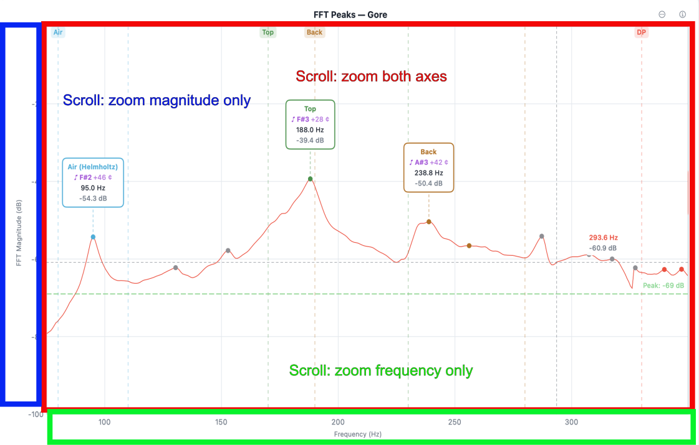

# Chapter 6 — Working with the Spectrum

The spectrum chart is the centrepiece of the analysis screen.
This chapter covers the gestures, shortcuts, and settings that
let you read it the way you want without disturbing the
measurement itself.

## 6.1 Live vs. Frozen Spectrum

Before a tap registers, the spectrum is **live** — the chart
redraws on every FFT frame, showing the current microphone input
in real time. Use this state to monitor ambient noise, dial in
Threshold and Peak Min while paused (§2.6, §2.7), or simply
confirm the microphone is working.

When a tap registers, the spectrum **freezes** on the capture so
you can inspect peaks, drag labels, and read the Analysis Results
panel without the chart moving under you. The status bar shows
"Tap Detected" when the freeze happens.

Pressing **New Tap** discards the frozen capture (or current
sequence) and returns to live mode, arming the detector for the
next tap.

## 6.2 Zooming and Panning — iOS and iPadOS

- **Pinch** anywhere over the plot area to zoom both axes.
- **Pinch over the frequency axis** (the bottom of the chart) to
  zoom the frequency axis only.
- **Pinch over the magnitude axis** (the left edge) to zoom the
  magnitude axis only.
- **Drag** over the plot area to pan both axes. Drag over a
  single axis to pan that axis only.

With a mouse or trackpad connected, scrolling and right-clicking
work as on the desktop (§6.3), and with a keyboard so do the
modifier keys.

To reset the view, tap the **⋯** button in the upper-right corner
of the spectrum chart. The chart menu opens — the same menu on
every platform, and the one a right-click opens:

- **Reset Both Axes to Saved**, **Reset Frequency Axis to Saved**,
  **Reset Magnitude Axis to Saved** return the chosen axis (or
  both) to the view stored as your default — see §6.8.
- **Reset Both Axes to Defaults**, **Reset Frequency Axis to
  Defaults**, **Reset Magnitude Axis to Defaults** return the
  chosen axis (or both) to the app's built-in starting range.
- **Reset Labels** moves dragged peak labels back to their
  auto-positions; it is available when any label has been
  dragged (§6.6).

While a comparison measurement is shown (§3.9), Saved and Defaults
have no meaning — the comparison holds measurements of many
guitars — so the chart menu has one group in their place:

- **Reset Both Axes to Comparison Range**, **Reset Frequency Axis
  to Comparison Range**, **Reset Magnitude Axis to Comparison
  Range** return the chosen axis (or both) to the comparison
  range: the span of the compared measurements' saved views, from
  the lowest to the highest of them — where the comparison opened.

## 6.3 Zooming and Panning — macOS, Windows, and Linux Desktop

Desktop interaction follows the same pattern as iOS/iPadOS but
uses the scroll wheel and modifier keys. The chart is divided into
three hover zones, each with its own scroll behaviour:

<!--
SCREENSHOT:

  File:    images/ch06-scroll-zones.png
  Subject: macOS Guitar Tap window with the chart visible, an
           overlay highlighting the three scroll-zones:
             1. Plot area (the main chart region) — labelled
                "Scroll: zoom both axes".
             2. Frequency axis (bottom strip below the chart) —
                labelled "Scroll: zoom frequency only".
             3. Magnitude axis (left strip beside the chart) —
                labelled "Scroll: zoom magnitude only".
  Notes:   The overlay can be drawn on top of a real screenshot
           with transparent fill colours and labels. Crop to the
           window only.
-->

{: .screenshot-desktop }

- **Scroll over the plot area** to zoom both axes simultaneously.
- **Scroll over the frequency axis** (the bottom of the chart) to
  zoom the frequency axis only.
- **Scroll over the magnitude axis** (the left edge) to zoom the
  magnitude axis only.
- **Drag** in any of the three zones to pan with the same
  axis-sensitivity rules.

Modifier keys augment scrolling without changing which zone you
are in:

| Modifier | Scroll effect |
|---|---|
| ⇧ Shift | Pan the frequency axis |
| ⌥ Option (macOS) / Alt (Windows / Linux) | Pan the magnitude axis |
| ⌘ Command or ⌃ Control (macOS) / Ctrl (Windows / Linux) | Zoom both axes around the pointer |

On a Mac trackpad, two-finger **pinch** works the same as
scroll-wheel zoom — over the plot area for both axes, over an axis
for that axis only. On Windows and Linux a trackpad pinch zooms
both axes, as Ctrl + scroll does.

To reset the view, click the **⋯** button in the upper-right
corner of the chart, or **right-click** anywhere in the chart
area: both open the chart menu (§6.2 lists its items).

Two icons sit in the upper-right corner of the spectrum chart: the
**⋯** button (the chart menu, above) and the **ⓘ** button, which
opens a Zoom & Pan Controls popover listing the gestures and
modifier keys that work on the computer or device in use.

## 6.4 Auto dB

**Auto dB** scales the magnitude axis to fit the current signal:
the floor moves to just below the lowest visible value and the
ceiling to just above the highest. It is the fastest way to land
on a sensible magnitude range after a measurement, especially when
the captured tap was much louder or quieter than the live signal
that preceded it.

A button in the toolbar invokes Auto dB. The keyboard shortcut is
**⌘0** on macOS; **Ctrl+0** on Windows and Linux.

Use Auto dB after each measurement, or any time the spectrum
clips or sits flat against the magnitude floor.

## 6.5 The Crosshair (iOS and iPadOS)

The crosshair is a touch-based readout for inspecting frequency
and magnitude at any point on the chart.

1. Tap the crosshair icon  in the toolbar to enable it. The icon switches to  while crosshair mode is active.
2. Touch and drag anywhere on the chart. A vertical and
   horizontal line follow your finger; a small readout shows the
   frequency (Hz) and magnitude (dB) under the crosshair.
3. Tap the icon again to disable.

The crosshair is a read-only tool — it does not change the
selected peaks, the spectrum, or any saved state. On desktop
there is no toggle; the crosshair follows the mouse pointer
continuously whenever the pointer is over the chart, showing the
frequency and magnitude under the cursor in real time.

## 6.6 Peak Labels

Each annotated peak carries a label showing the mode name,
frequency (and pitch with cents offset in guitar mode). Labels are
positioned automatically to minimise overlap, but you can move any
label to a position you prefer.

- **Drag** a label to reposition it. The new position is saved
  with the measurement and restored when the measurement is
  reloaded.
- **Reset an individual label** — right-click it and choose
  **Reset Position**. On a phone or tablet — iPhone, iPad, or the
  web app on Android — long-press it (on a tablet with a mouse or
  trackpad, a right-click works too).
- **Reset all labels** — choose **Reset Labels** from the chart
  menu: the **⋯** button in the upper-right corner of the spectrum
  chart, or a right-click on the chart.

## 6.7 Annotation Modes

The **Annotations** button cycles through three states that
control which peaks are labelled on the chart:

- **All** — every detected peak is labelled. Useful for surveying
  a spectrum where you have not yet decided which peaks matter.
- **Selected** (default) — only peaks currently selected for
  analysis are labelled. Matches what most luthiers want during
  normal use.
- **None** — no labels. Useful for clean export images or for
  reading the bare spectrum shape without distractions.

In **plate** and **brace** mode there is no per-peak selection —
the identified Longitudinal, Cross-grain, and (when measured) Diagonal peaks
*are* the measurement, not a subset you choose (see §4.9). So
**All** and **Selected** label the same set — all of them — and
only **None** clears the labels. Guitar mode is the only place
Selected differs from All (§3.6).

Cycle via the Annotations button, or with the keyboard shortcut
**⌘`** on macOS / **Ctrl+`** on Windows and Linux.

Annotation mode applies to the current view only — it is not
saved with the measurement, and does not affect which peaks
contribute to derived values (selection does that, see §3.6).

## 6.8 The Chart's Range and Your Saved View

Each measurement type — each guitar type, plate and brace — has
its own **saved frequency range**: its home view. The magnitude
(dB) range is saved once for all types. The chart starts at the
saved view when Guitar Tap opens and when you switch measurement
type, and the chart menu's **Reset … to Saved** items (§6.2)
return to it.

The saved view is a starting point, not a limit — zoom and pan
freely. The chart moves only when:

- **you move it** — zooming, panning, a reset, or a new range
  entered in Settings;
- **a measurement is loaded** — the chart shows the range that
  measurement was saved with;
- **a plate or brace peak lands outside it** — when fL, fC or fFLC
  is identified off the edge of the chart, the chart widens just
  enough to show it. A guitar's view is never widened: it is the
  window you chose to analyse;
- **you switch measurement type** — the chart moves to that type's
  saved view.

Nothing else moves it. **New Tap**, **Play File** and closing
Settings without changing the range leave the chart where it is,
so a view you zoomed to stays while you repeat a tap. The one
exception follows a load: the loaded range belonged to that
measurement, so New Tap or Play File returns to your saved view —
unless you have zoomed or panned since the load, in which case
the chart stays where you put it.

A widened chart and a loaded range never change the saved view.
Only two things do: the range fields in Settings (§8.4), and
**Save Current View**.

### Saving the current view

Once you have zoomed and panned to a view you want as the home
view for the current measurement type, save it:

**Settings → Advanced → Display Settings → Save Current View**

What is saved: the **frequency range** (low and high Hz) for the
current measurement type, and the **magnitude range** (low and high
dB) for all types — exactly as shown, so a reset to Saved brings
back the same view, with a peak at the chart's edge still on the same
side of it.

