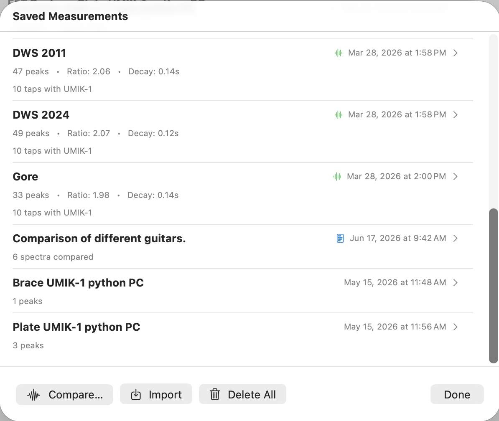
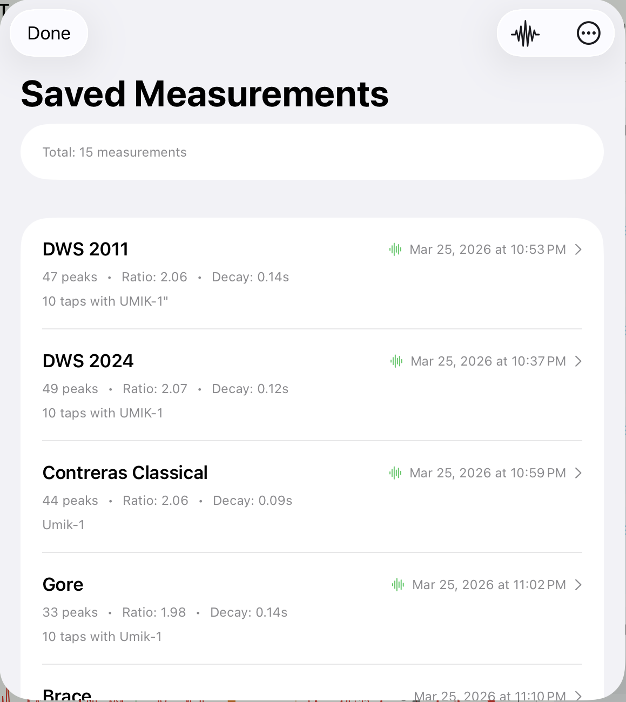

# Chapter 7 — Saving, Exporting, and Sharing Measurements

This chapter is a complete reference for everything you can do with
a measurement after capture: store it, review it, send it
elsewhere, and bring it back later.

## 7.1 Saving a Measurement

Press **Save**  in the toolbar to store the
current measurement. Save is enabled whenever there is a finished
measurement on screen — a frozen single tap, a complete plate or
brace multi-phase capture, or an active comparison overlay — and
disabled when the spectrum is live or no peaks have been
identified.

The Save sheet has two fields, both optional:

- **Name** — a short label identifying what you measured. For a
  guitar measurement this is typically the luthier's name for the
  instrument (a serial number, a project name, a working title).
  For a plate or brace it is the identifier for that specific
  piece (a board number, supplier code, billet label). If left
  blank, the date and time serve as the name.
- **Notes** — free text. Use it to record provenance, build-stage
  context, dimensions you measured by hand, or anything else you
  want to carry alongside the data.

What is stored depends on the type of measurement:

- **Guitar / plate / brace** — the spectrum (or 2–3 spectra for a
  plate measurement, one per phase), detected peaks and
  selections, settings active at capture time (subtype, plate
  dimensions, threshold, peak min, and so on), annotation
  positions, and mode overrides.
- **Comparison** — the constituent spectra (one per measurement
  that was being compared) and their colours, plus the
  Comparison Results table. Saving a comparison does not consume
  the individual measurements that were combined; they remain in
  the list as separate entries.

Keyboard shortcut: **⌘S** on macOS; **Ctrl+S** on Windows and
Linux.

After Save, the measurement appears at the top of the Measurements
list (§7.2).

## 7.2 Viewing Saved Measurements

<!--
SCREENSHOT:

  File:    images/ch07-measurements-list.png
  Subject: Saved Measurements window showing a mix of saved items:
           several guitar measurements with the waveform indicator,
           at least one plate and one brace (no indicator), and at
           least one saved comparison with the chart indicator.
           Bottom toolbar showing Compare…, Import…, Delete All,
           Done buttons.
  Notes:   Use a real set of measurements so the dates and notes
           are plausible. Crop tight to the window.
-->

{: .screenshot-desktop }

Open the Measurements list with the toolbar **Measurements**
button , or with **⌘L** on macOS / **Ctrl+L**
on Windows and Linux.

Each row carries up to three lines plus a trailing column:

- **Line 1** — the **name** (bold; "Measurement" or "Comparison"
  as a fallback when no name has been set), and on the right a
  waveform indicator 〜 for guitar
  measurements that have a captured spectrum, a chart indicator
  for saved comparisons, the **date and time** of capture, and a
  chevron.
- **Line 2** — for guitar measurements: peak count, tap-tone
  ratio (if available), and decay time (if available). For
  comparisons: "*N* spectra compared". For plate / brace: peak
  count and the headline material values.
- **Line 3** — the notes you entered on Save, if any.

The list is shown in the order the measurements were saved —
newest entries appear at the bottom — not sorted by date or name.

## 7.3 Loading a Measurement into the View

Either **double-click** the measurement row, or open the popup
menu on the row (right-click on desktop, long-press on iOS /
iPadOS) and choose **Load into View**.

What is restored on load:

- The frozen spectrum and its peaks
- Annotation positions
- Mode overrides
- The settings that were active at capture time

Loading a measurement replaces the analyzer's **current**
settings — threshold, Peak Min, Taps, measurement type, and so on
— with the values that were active when the measurement was
captured. Your **saved** Settings values are untouched.

The status bar shows a **"loaded settings"** notice while this is
in effect. The notice matters because pressing **New Tap** with
the loaded settings active will capture using the loaded
measurement's values, not the ones you had configured before. If
that is not what you want, change Settings (or load a different
measurement whose settings you do want) before tapping.

Loading a saved comparison restores all constituent spectra as
the overlay, brings up the Comparison Results table, and switches
the view into comparison mode.

## 7.4 Viewing Measurement Details

Open the popup menu on a measurement row (right-click on desktop,
long-press on iOS / iPadOS) and choose **View Details**, or tap
the row directly.

The detail view is read-only. It contains:

- The peak table (mode, frequency, magnitude, Q, bandwidth, pitch
  for guitar mode; the equivalent fields for plate / brace)
- The analysis summary (decay time and Tap Tone Ratio for guitar;
  E_L, E_C, specific modulus, quality rating, Gore thickness for
  plate / brace)
- The name and notes

For a comparison, the detail view shows the list of constituent
spectra and the Air / Top / Back frequency table.

Load, Edit Name & Notes, and the export actions are reached from
the popup menu on the row in the Measurements list, not from this
view.

To dismiss the detail view: click the window's close button on
macOS, press **Close** in the Python desktop build, or tap
anywhere outside the dialog on iOS / iPadOS.

## 7.5 Editing Name and Notes

You can change a measurement's name or notes at any time after it
has been saved.

Open the popup menu on the measurement row (right-click on
desktop, long-press on iOS / iPadOS) and choose **Edit Name &
Notes**. The edit sheet has the same two fields as Save. Tapping
Save in the sheet commits the change immediately — there is no
separate confirm step and no undo.

## 7.6 Exporting a Spectrum Image

Produces a PNG of the chart at display resolution. The image
reflects whatever the measurement contains: a single tap is
exported as one frozen spectrum with annotations, a plate
measurement is exported with all of its phase spectra, and a
comparison is exported as the overlay with every coloured curve,
its label, and the legend.

Two ways to invoke it:

- For a measurement on screen — press the **Export Spectrum**
  button at the bottom of the Analysis Results window. Keyboard
  shortcut: **⌘E** on macOS; **Ctrl+E** on Windows and Linux.
- For a saved measurement — open the popup menu on its row in
  the Measurements list and choose **Export Spectrum**.

## 7.7 Exporting a PDF Report

Bundles the chart, the data, and the metadata into a single
shareable PDF. Like the spectrum image export, this works on any
measurement; the PDF contents follow the measurement type:

- **Guitar** — spectrum image, peak frequency table (mode,
  frequency, magnitude, Q, bandwidth, pitch), and the analysis
  summary (decay time and Tap Tone Ratio).
- **Plate / brace** — spectrum image(s) for the captured phases,
  the peak table, and the material properties (E_L, E_C, specific
  modulus, radiation ratio, quality rating, and Gore thickness for
  plate).
- **Comparison** — a header listing the constituent measurements,
  the overlay spectrum image, and the Air / Top / Back frequency
  table with one column per constituent.

Every PDF carries a metadata header with the date, name, and
notes.

Two ways to invoke it:

- For a measurement on screen — press the **Export PDF Report**
  button at the bottom of the Analysis Results window. Keyboard
  shortcut: **⇧⌘E** on macOS; **Ctrl+Shift+E** on Windows and
  Linux.
- For a saved measurement — open the popup menu on its row in
  the Measurements list and choose **Export PDF Report**.

## 7.8 Exporting a Measurement

The native portable container is the **`.guitartap`** file — a
self-contained snapshot of a saved measurement that can be moved
to any other device and re-opened without loss.

What it contains: the peaks (with selections and mode overrides),
the full spectrum data (Base64-encoded little-endian float32
arrays for frequency and magnitude), annotation positions, and
the settings active at capture time. For a measurement that holds
more than one spectrum — a plate measurement with its 2 or 3
phase captures, or a comparison with its constituent waveforms —
every spectrum is embedded, so the file is larger but stays fully
self-contained.

Which popup-menu item to use depends on platform:

- **iOS / iPadOS:** **Export Measurement** → system share sheet
  (AirDrop, Mail, Files, etc.).
- **macOS (native build):** either **Export Measurement** (system
  share sheet) or **Save Measurement to Disk…** (file-save
  dialog).
- **Python build (Windows / Linux / macOS Python):** **Export
  Measurement** → file-save dialog. There is no share sheet on
  these platforms, so the action behaves the same way as Swift
  macOS's Save Measurement to Disk…

The file extension is **`.guitartap`** on every platform, and the
format is interchangeable across iOS, iPadOS, macOS, Windows, and
Linux builds.

## 7.9 Importing a Measurement

<!--
SCREENSHOT:

  File:    images/ch07-measurements-list-ios.png
  Subject: Saved Measurements dialog on iOS / iPadOS, with the
           ellipsis menu in the upper-right corner expanded to show
           "Import Measurement" and "Delete All". Capture in light
           mode to match the macOS screenshot.
  Notes:   The iOS dialog layout differs from macOS — there is no
           separate row of Compare / Import / Delete All buttons
           along the bottom. Crop tight to the dialog.
-->

{: .screenshot-mobile }

The access path differs between platforms:

- **iOS / iPadOS:** open the Saved Measurements dialog, tap the
  ****
  menu in the upper-right corner, and choose **Import
  Measurement**. (The same menu also hosts **Delete All**.)
  The Files picker opens; select a `.guitartap` to import.
- **Desktop (macOS native and Python builds):** **File → Import
  Measurement** opens a file picker. Drag-and-drop onto the
  Saved Measurements window also works.

The imported measurement appears in the list regardless of its
type — guitar, plate, brace, or comparison.

If the input device named in the imported file is not available
on the current system, the import still succeeds and the imported
data is unchanged. A warning is shown **after** the import
completes, letting you know that further capture will use a
fallback input device until the original is reconnected.

## 7.10 Sharing Between Devices

Anything you can export — measurements (§7.8), spectrum images
(§7.6), or PDF reports (§7.7) — can be shared between devices.
Which action to use depends on where the file is going.

**Apple ecosystem (iOS, iPadOS, macOS native build).** Use the
**Export Measurement**, **Export Spectrum**, or **Export PDF
Report** popup-menu actions. Each opens the system share sheet,
from which:

- **AirDrop** sends directly to a nearby Apple device.
- **iCloud Drive / Files** stores the file to iCloud; the
  receiver opens it from Files on their device.
- **Mail / Messages** attaches the file; the recipient taps the
  attachment to open it.

**Non-Apple devices and archival.** Use **Save Measurement to
Disk…** (macOS popup menu) — which is the file-save path, not a
share-sheet path — to write a `.guitartap` directly to a folder
of your choice. On Python desktop builds (Windows, Linux, and
macOS Python) the **Export Measurement** action opens the same
kind of save dialog, since no system share sheet exists on
Windows or Linux. From disk the file can travel via any
cross-platform channel — Dropbox, Google Drive, email, USB drive,
network share — and the receiver imports it with §7.9. This same
disk-save path is the right choice when you simply want a
permanent file copy outside the app's library.

**Cross-platform example.** Export from a Windows or Linux build
with the **Export Measurement** action — which opens a save
dialog on those platforms — transfer the resulting `.guitartap`
file to an iPhone or iPad (via Files, email, Dropbox, etc.), and
import it on the receiving Apple device via §7.9. The
`.guitartap` format is identical on every platform, so no
conversion is needed regardless of direction.

## 7.11 Deleting Measurements

- **Desktop:** popup menu → **Delete**.
- **iOS / iPadOS:** swipe-to-delete on the row.

A confirmation prompt appears before deletion so an accidental
click or swipe does not lose data. Deleting a measurement removes
it and any data embedded in it; nothing else in the list is
affected. Because a comparison embeds copies of its constituent
spectra at save time, deleting an individual measurement that was
previously combined into a comparison leaves that comparison
intact, and deleting a comparison leaves its source measurements
intact.
