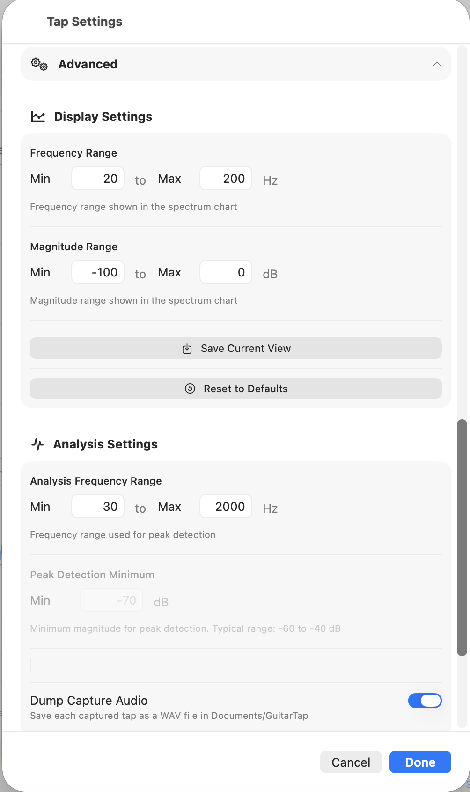

# Chapter 8 — Settings Reference

The Settings sheet collects every persisted configuration the
analyzer uses: audio input, measurement-type-specific inputs (mode
frequency windows for guitar, dimensions for plate / brace), and
the Advanced display- and analysis-tuning values.

This chapter is the reference for every field. Workflow context
for the most-used ones — choosing a measurement type, tuning
threshold and peak min, importing a calibration — lives in
Chapter 2.

## 8.1 Opening Settings

- **iOS / iPadOS:** tap the **Settings**  icon in the
  main toolbar.
- **macOS (native build):** **Guitar Tap → Settings…** in the
  application menu, or **⌘,**.
- **Python desktop (macOS Python):** **Guitar Tap → Settings…**
  in the application menu, or **⌘,**, or the **Settings**
  button in the toolbar.
- **Python desktop (Windows / Linux):** **File → Settings…**, or
  **Ctrl+,**, or the **Settings** button in the toolbar.

Changes apply immediately (no Apply step) and persist across
launches.

## 8.2 Audio Input & Calibration

- **Input device** — picker listing the microphones available on
  the current system. Selecting a device makes it the active
  input.
- **Calibration** — shows the calibration file currently
  associated with the active input device, or "None".
- **Import Calibration File** — opens a file picker; accepts
  `.txt` and `.cal` two-column (frequency, dB) files. The
  selected file is bound to the currently active device and
  reloads automatically when you next select that device.
- **Clear All Calibrations** — removes every stored calibration
  across all devices. Use when you want a clean baseline.

See §2.3 and §2.4 for the workflow.

### Capture sample rate

GuitarTap captures at whatever sample rate the operating system provides
for the selected input device — it does not override it. The rate is set
outside the app:

- **macOS:** *Audio MIDI Setup* (in `/Applications/Utilities`). Select the
  input device and choose a Format rate. Because the app's audio context
  follows the default **output** device, set both the input and the output
  device to the same rate (e.g. 48 000 Hz) to avoid resampling.
- **Windows:** *Sound settings → Device properties → Advanced* (Default
  Format). **Linux:** your audio server's configuration (e.g. PipeWire/JACK).

Why it matters: the analysis frequency resolution and the captured spectrum
are tied to the rate, so the same instrument measured at a different rate
will read slightly differently. The rate in effect is **recorded with each
measurement** (see Appendix B) so that loading a measurement can warn you if
your current setup differs — see §10.7.

## 8.3 Measurement Type

The Measurement Type section adapts to the type you select.

**Guitar subtype** — pick one of:

- **Generic Guitar** — broad frequency windows; recommended
  default.
- **Acoustic Guitar** — narrower windows tuned for steel-string
  flat-tops.
- **Classical Guitar** — windows for classical builds.
- **Flamenco Guitar** — windows for flamenco builds.

Below the subtype picker, **Mode Frequency Ranges** displays the
windows the analyzer uses to classify air, top, back, dipole,
ring, and upper modes for the chosen subtype. The display is
read-only — the windows are a property of the subtype, not a
user-tunable value.

**Plate** — the section reveals the plate inputs (described in
detail in §4.3):

- **Length** (mm) — along the grain.
- **Width** (mm) — across the grain.
- **Thickness** (mm).
- **Mass** (g).
- **Calculated Density** — live preview computed from the four
  values above; sanity-check against the expected range for the
  wood (spruce: 0.35–0.45 g/cm³).
- **Body Length** (mm) and **Lower Bout Width** (mm) — used by
  the Gore target thickness calculation.
- **Plate Stiffness Preset** — Steel String Top (75), Steel
  String Back (55), Classical (50), or Custom. See §4.3 for the
  Custom calibration workflow.
- **Measure FLC** — when on, the sequence runs in three phases
  (L, C, FLC) instead of two (L, C).

**Brace** — the section reveals the brace inputs (described in
detail in §5.2):

- **Length (along grain)** (mm).
- **Width (breadth)** (mm).
- **Height (tap direction)** (mm) — the `t` dimension in the
  stiffness formula. The Settings panel includes a helper line
  below the field to flag this.
- **Mass** (g).
- **Calculated Density** — same live preview as the plate
  section.

## 8.4 Advanced — Display Settings

Tap **Advanced** to reveal these.

- **Frequency Range** — min and max Hz shown on the spectrum
  chart. Defaults are wide enough to cover guitar / plate /
  brace ranges; narrow them when you want a closer look at a
  specific band.
- **Magnitude Range** — min and max dB shown on the chart.
- **Save Current View** — saves the *current* chart axes
  (frequency and magnitude ranges) as your default. Reset to
  Saved in the chart's **…** menu (§6.2) returns to this view.
- **Reset to Defaults** — restores the built-in starting ranges.

## 8.5 Advanced — Analysis Settings

<!--
SCREENSHOT:

  File:    images/ch08-settings-advanced.png
  Subject: Settings sheet on macOS scrolled to the Advanced
           section, with the disclosure expanded so both the
           Display Settings and Analysis Settings sub-sections
           are visible. Captured in guitar mode so the
           Peak Detection Minimum field is enabled and the Show
           Unknown Modes toggle is shown.
  Notes:   Crop to the settings sheet only.
-->

{: .screenshot-panel }

- **Show Unknown Modes** (guitar only) — when on, peaks that do
  not fall within any classified mode window are still annotated
  on the chart. On by default; turn off to declutter a chart
  intended for sharing. (Cross-ref §3.1.)
- **Analysis Frequency Range** — min and max Hz used for peak
  detection. Distinct from the *display* frequency range above:
  this controls which peaks the analyzer considers, not what is
  shown on the chart.
- **Peak Detection Minimum** (guitar only) — the same Peak Min
  value as the toolbar slider (§2.7); the Settings field accepts
  a precise numeric value. Sets the minimum magnitude (dB) a peak
  must reach to be annotated and included in the analysis. A saved
  guitar measurement retains its full peak set, so Peak Min can be
  lowered later on a loaded measurement to reveal quieter peaks
  (§2.7). Typical range: −60 to −40 dB. Disabled in plate / brace
  mode (the per-phase capture uses its own adaptive noise floor).
- **Dump Capture Audio** — when on, each measurement's captured
  audio is saved as one continuous mono 32-bit-float WAV file. Useful
  as an archive of a measurement, or for debugging; leave off if you
  don't need it.

  When enabled, a **folder row** appears beneath the setting showing
  where the files are saved, with buttons to work with that folder:
    - **macOS:** *Show in Finder* opens the folder; *Change…* lets you
      pick any folder (the app remembers your choice across launches);
      *Use Default* returns to the app's own storage. The default is
      inside the app's container; use *Change…* to send dumps to, for
      example, `~/Documents/GuitarTap`.
    - **Desktop (Python build — macOS / Windows / Linux):** the same
      *Open Folder* / *Change…* / *Use Default* controls. The default
      is your **Documents** folder + `GuitarTap` (your real Documents
      location, including a redirected or OneDrive Documents).
    - **iPhone / iPad:** the app's Documents directory (not settable),
      reachable via **Files → On My iPhone/iPad → Guitar Tap**.
    - **Browser (web build):** files download to your browser's
      **Downloads** folder (not settable — the browser controls where
      downloads go).

  The folder is expected to stay where you put it: if you **rename,
  move, delete, or trash** it (or it's on a drive that isn't mounted),
  Guitar Tap can no longer reach it. When that happens — on **New Tap**,
  and also at launch, since Guitar Tap arms for a tap automatically when
  it opens — it asks you to **Change Location**, **Turn Off Saving**, or
  **Cancel** before the measurement starts, so a recording is never lost
  to a missing folder. **Cancel** leaves the detector idle; press **New
  Tap** again when you're ready.

  File names are timestamped and prefixed by the originating build —
  `swift_<label>_<timestamp>.wav`, `python_<label>_<timestamp>.wav`, or
  `web_<label>_<timestamp>.wav` — so dumps from cross-platform
  comparison runs are easy to tell apart.
- **Reset Analysis Settings** — restores the analysis defaults.

## 8.6 About & Help

The final section of the Settings sheet carries three items:

- **Version** — the running build's version string.
- **Copyright** — the copyright line from the app's bundle
  metadata.
- **Quick Start Guide**  — opens the in-app
  Quick-Start Guide. The content matches the printable Quick-Start
  PDF that ships with the app.
- **User Manual** — opens the full User Manual (this document) in
  the system default browser. Requires an internet connection;
  the manual is hosted at dolcesfogato.com.
