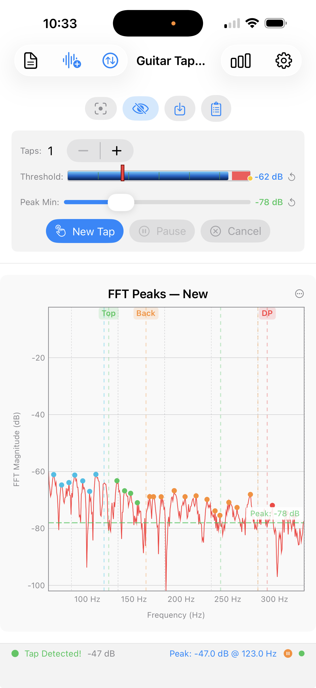
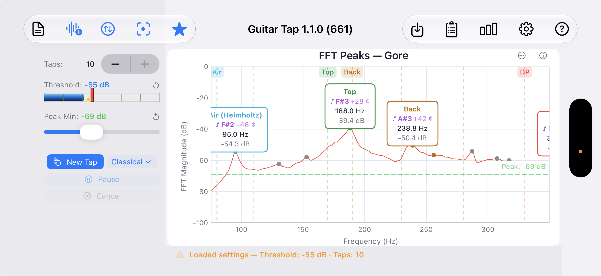
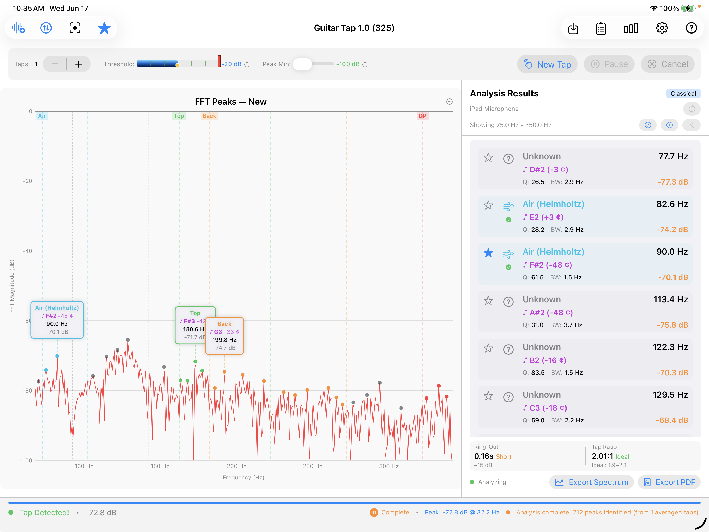
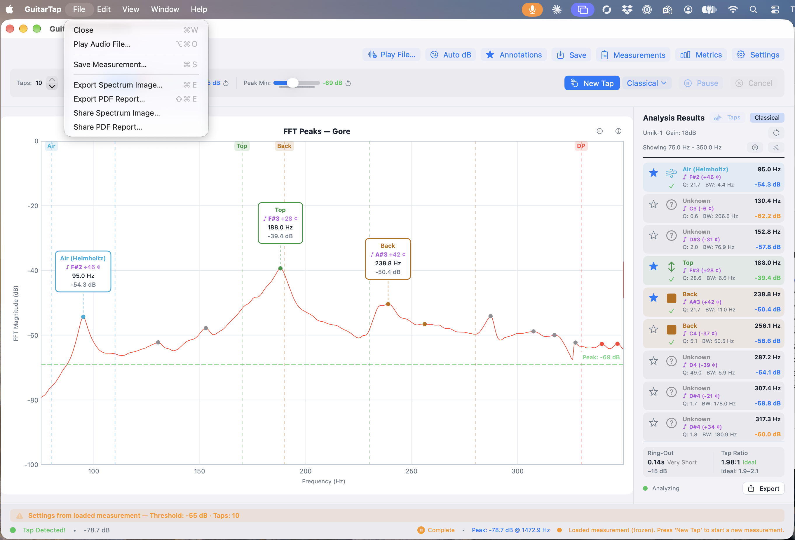

# Chapter 9 — Controls Reference

A scannable reference for every button, control, and gesture.
For the workflows that exercise them, see Chapters 3–7. For the
chart-interaction details, see Chapter 6.

## 9.1 Toolbar — iOS iPhone (Portrait)

<!--
SCREENSHOT:

  File:    images/ch09-iphone-portrait.png
  Subject: iPhone in portrait, screenshot cropped to the top of the
           main screen so the three stacked control rows are clearly
           visible: the navigation toolbar (Results, Play File,
           Auto dB on the left; Metrics, Settings on the right), the
           secondary icon row (Crosshair, Annotations, Save,
           Measurements), and the top of the Tap Controls panel. The
           spectrum chart may be visible below but is not the focus.
  Notes:   Capture in light mode. Crop tight enough that the three
           rows fill the image.
-->

{: .screenshot-mobile }

Vertical layout with three stacked control rows above the chart.

**Top — navigation toolbar:**

- **Leading (left):** Results ,
  Play File ,
  Auto dB .
- **Trailing (right):** Metrics ,
  Settings .

**Middle — secondary icon row** (just below the toolbar):

- Crosshair ,
  Annotations ,
  Save ,
  Measurements .

**Bottom — Tap Controls panel** (§9.6):

Taps stepper, Threshold slider, Peak Min slider, and the action
buttons New Tap / Pause-Resume-Accept / Cancel-Redo.

## 9.2 Toolbar — iOS iPhone (Landscape)

<!--
SCREENSHOT:

  File:    images/ch09-iphone-landscape.png
  Subject: iPhone in landscape, showing the full app screen with the
           tap-controls / spectrum split. The navigation toolbar
           across the top should be clearly legible — leading items
           on the left, trailing on the right.
  Notes:   Capture with a measurement loaded so the chart, peak
           annotations, and trailing icons (Save / Measurements /
           etc.) are all populated. Light mode.
-->

{: .screenshot-mobile-wide }

Horizontal split layout with the **Tap Controls** in a vertical
panel on the left and the spectrum chart filling the right side.
The navigation toolbar runs across the top of the screen.

- **Leading:** Results ,
  Play File ,
  Auto dB ,
  Crosshair ,
  Annotations .
- **Trailing:** Save ,
  Measurements ,
  Metrics ,
  Settings ,
  Help .

The Tap Controls panel scrolls vertically when there is not
enough height to show every control at once.

## 9.3 Toolbar — iOS iPad

<!--
SCREENSHOT:

  File:    images/ch09-ipad.png
  Subject: iPad showing the inline three-pane layout: Tap Controls
           panel at the top, spectrum on the left below, and the
           Analysis Results panel on the right. The navigation
           toolbar at the very top should be clearly visible —
           leading: Play File, Auto dB, Crosshair, Annotations;
           trailing: Save, Measurements, Metrics, Settings, Help.
           Note: no Results button on the toolbar.
  Notes:   Either orientation works — the layout is the same.
           Capture with a completed guitar measurement so all
           buttons in the toolbar are populated. Light mode.
-->

{: .screenshot-tablet }

iPad uses a single layout in both portrait and landscape (the
horizontal size class is `.regular` in either orientation, so the
same inline three-pane arrangement applies). The Analysis Results
panel is shown inline alongside the chart — like the desktop
layout — so the toolbar does **not** include a Results button.

- **Leading:** Play File ,
  Auto dB ,
  Crosshair ,
  Annotations .
- **Trailing:** Save ,
  Measurements ,
  Metrics ,
  Settings ,
  Help .

The full Tap Controls panel is visible above the chart in both
orientations.

## 9.4 Menu Bar — Desktop

<!--
SCREENSHOT:

  File:    images/ch09-desktop.png
  Subject: Guitar Tap on macOS (or any desktop platform — Python on
           Windows, Linux, or macOS works equivalently). Show the
           full window with the toolbar and chart visible, plus one
           menu pulled down (the File menu is the most informative —
           it shows Play Audio File…, Save Measurement…, Export
           Spectrum Image…, Export PDF Report… and their keyboard
           shortcuts).
  Notes:   macOS native or Python desktop, your choice — the
           top-of-window toolbar layout is essentially identical
           between them. Light mode.
-->

{: .screenshot-desktop }

Both the Swift native macOS build and the Python desktop build
(Windows, Linux, macOS Python) expose the same operations through
a menu bar. The placement and shortcuts differ per platform
following the host OS conventions.

**Application menu** (macOS — both native and Python; on Windows
and Linux these items move into the File and Help menus per the
notes below):

| Item | macOS shortcut |
|---|---|
| About Guitar Tap | (system default) |
| Settings… | ⌘, |
| Quit Guitar Tap | ⌘Q |

**File menu:**

| Item | macOS shortcut | Windows / Linux shortcut |
|---|---|---|
| Close (macOS only) | ⌘W | — |
| Play Audio File… | ⌘⌥O | Ctrl+Alt+O |
| Save Measurement… | ⌘S | Ctrl+S |
| Export Spectrum Image… | ⌘E | Ctrl+E |
| Export PDF Report… | ⇧⌘E | Ctrl+Shift+E |
| Settings… (Win / Linux Python only) | — | Ctrl+, |
| Exit / Quit (Win / Linux Python only) | — | (system default) |

**View menu:**

| Item | macOS shortcut | Windows / Linux shortcut |
|---|---|---|
| Auto dB | ⌘0 | Ctrl+0 |
| Cycle Annotations | ⌘\` | Ctrl+\` |
| Show Metrics | ⌘M | Ctrl+M |
| Show Measurements | ⌘L | Ctrl+L |

**Help menu:**

| Item | macOS shortcut | Windows / Linux shortcut |
|---|---|---|
| Quick Start Guide | ⌘? | F1 |
| User Manual | — | — |
| About Guitar Tap… (Win / Linux Python only) | — | (no default) |

## 9.5 Individual Controls

Each entry: icon, name, what it does, and any platform notes.
Keyboard shortcuts are given in macOS form first followed by
Windows / Linux where they differ.

**New Tap**  — Arms the tap detector, clears the
frozen spectrum, and returns to the live view. Also exits
comparison mode when a comparison is active. Enabled except
while a measurement is actively being captured (and when
detection is unavailable).

**Play File**  — Opens a
file picker; the selected audio file is fed through the analysis
pipeline as if it were live microphone input. Useful for analyzing
captured WAVs or running the analyzer against a reference
recording. The icon tints orange while a file is playing. Also
reached from the desktop menu bar (**File → Play Audio File…**,
**⌘⌥O** macOS / **Ctrl+Alt+O** Windows / Linux).

**Pause**  /
**Resume**  /
**Accept**  — A
single button whose label and icon change with state.
**Pause** suspends tap detection while keeping the spectrum live
— use it to tune Threshold and Peak Min freely (§2.6, §2.7).
**Resume** re-arms detection. **Accept** (green) replaces the
pair during plate / brace review phases (§4.5) and locks in the
current phase result before advancing.

**Cancel**  /
**Redo**  —
A single button whose label and icon change with state.
**Cancel** discards the active sequence and returns to the live
view. During a plate / brace review phase it becomes **Redo L**,
**Redo C**, or **Redo FLC** (orange) and re-arms detection for
that phase only (§4.5).

**Results**  (iPhone only) — Opens the
Analysis Results sheet.

**Re-analyze**  —
In the Analysis Results header, next to the microphone name. Re-runs
peak detection on a loaded measurement's stored spectrum using the
current analysis settings — useful for trying a different Peak Min,
analysis range, or guitar type on a saved measurement without
re-tapping. Enabled only when a loaded measurement is shown.

**Auto dB**  — Scales
the magnitude axis to fit the current signal (§6.4). Shortcut:
**⌘0** / **Ctrl+0**.

**Annotations**  /
 /
 —
Cycles through the annotation display modes: **All → Selected →
None → All …** (§6.7). The icon shows which state is currently
active. Shortcut: **⌘\`** / **Ctrl+\`**.

**Save**  —
Opens the Save Measurement sheet (§7.1). Enabled whenever there
is a finished measurement on screen — single tap, plate / brace
multi-phase capture, or active comparison overlay. Shortcut:
**⌘S** / **Ctrl+S**.

**Measurements**  —
Opens or closes the Measurements list (§7.2). Shortcut: **⌘L** /
**Ctrl+L**.

**Metrics**  — Opens or closes the FFT
Diagnostics panel (frame rate, FFT size, input level, and so
on). Shortcut: **⌘M** / **Ctrl+M**.

**Crosshair**  /
 (iOS /
iPadOS only) — Toggles the touch-readout crosshair (§6.5). On
desktop there is no toggle; the crosshair follows the mouse
pointer whenever the pointer is over the chart, showing the
frequency and magnitude under the cursor in real time.

**Chart Options**  (iOS / iPadOS
only) — Opens the **Chart Options** sheet from the upper-right
corner of the spectrum chart. Hosts the Reset to Saved and Reset
to Defaults groups, plus Reset Labels when there are dragged
labels to reset (§6.2, §6.6). On desktop the same actions are
reached by right-clicking the chart.

**Zoom & Pan Help**  (desktop only) — Shows a
summary popover of the scroll, modifier-key, and trackpad
gestures for axis zoom and pan (§6.3).

**Settings**  — Opens the Settings sheet
(Chapter 8). Shortcut: **⌘,** / **Ctrl+,**.

**Help**  — Opens a small menu with
two items: **Quick Start Guide** (the in-app help content; also
reachable directly via **⌘?** on macOS or **F1** on Windows /
Linux) and **User Manual** (opens the published manual in the
system browser). On iOS and iPadOS the menu lives behind the
toolbar **?** button; on desktop the same two items appear in
the **Help** menu bar.

## 9.6 Tap Controls

The Tap Controls panel groups the per-measurement settings and
action buttons. Its placement varies by platform — see §9.1
(iPhone portrait), §9.2 (iPhone landscape), §9.3 (iPad), and
§9.4 (desktop) for where it sits on each layout. The contents
themselves are the same everywhere:

- **Taps stepper (1 – 10)** — number of taps to capture in each
  guitar-mode sequence, or per phase in plate / brace mode (e.g.
  3 means three taps for Longitudinal, three for Cross-grain, and
  three for FLC if enabled). Disabled while a sequence is in
  progress and during comparison mode.

- **Threshold slider** — signal level (dB) that triggers tap
  detection (§2.6). The current value is shown next to the
  slider; the **reset arrow** restores the factory default.
  Range: −80 dB to −20 dB. Disabled during comparison mode.

- **Peak Min slider** — minimum spectrum magnitude (dB) at which
  a peak is annotated on the chart and included in guitar-mode
  analysis (§2.7, §8.5). The current value is shown next to the
  slider; the **reset arrow** restores the factory default.
  Range: −100 dB to −20 dB. In plate / brace mode the slider
  affects only what is drawn on the chart — the selected peak
  for each phase comes from the capture algorithm and is not
  changed by Peak Min. Disabled during comparison mode and during
  plate / brace measurements.

## 9.7 Status Bar

A thin status bar runs below the spectrum chart on every
platform and orientation. It is a read-only feedback area that
reflects the current state of the analyzer; the contents change
with state.

**Normal tap-detection (default).** Left to right:

- A circle indicator — green when a tap has been captured
  (label: **Tap Detected!**), grey while waiting (**Waiting for
  tap…**).
- The current input level in dB.
- During a multi-tap guitar sequence or a plate / brace sequence:
  a counter such as **Tap 2/3** or **Phase 1/2 · Tap 1/3**, plus
  a thin progress bar.
- **Peak: *X.X* dB @ *Y.Y* Hz** — the loudest spectrum bin in the
  current view, shown on the right side.
- A pause-fill glyph when the spectrum has frozen on a completed
  measurement.
- A small circle indicating audio-engine state — green for
  running, red for stopped.

**Loaded-settings warning.** After a saved measurement is loaded
(see §7.3) the bar shows an orange triangle and the message
**Loaded settings — Threshold: *X* dB · Taps: *N***. The notice
remains visible until you change Settings or start a fresh
capture.

**Comparison mode.** A waveform glyph and a one-line description
of the comparison — **Comparing *N* measurements** for a saved
comparison, or **Tap comparison — *N* taps + averaged** for the
multi-tap comparison view — plus a hint about how to exit the
mode (press **Taps** or **New Tap**).

The iPhone layout uses a single-line condensed version of this
bar; the iPad and desktop layouts use a slightly taller version
that stacks the warning above the tap-state row when both apply
at once.

## 9.8 Spectrum Chart Interactions

See Chapter 6 for a complete reference covering live and frozen
state, zoom / pan gestures and shortcuts, the **?** popover, the
crosshair, peak-label dragging and reset, and the Annotation
modes cycle.
