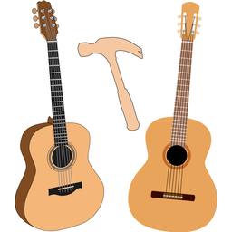

<p align="center">
  
</p>

<h1 align="center">Guitar Tap — Apple edition</h1>

<p align="center">
  <b>Tap-tone analysis for luthiers — capture a tap, run an FFT, and reveal a guitar's resonant modes and a tonewood's stiffness.</b>
</p>

<p align="center">
  <a href="https://apps.apple.com/app/guitar-tap/id6759410596">App Store</a> ·
  <a href="https://www.dolcesfogato.com/guitar_tap/">Website</a> ·
  <a href="https://www.dolcesfogato.com/guitar_tap/manual/">User Manual</a>
</p>

---

Tap-tone spectrum analysis for luthiers — the native **iPhone, iPad, and Mac** app.
Tap a guitar, tonewood plate, or brace, run a high-resolution FFT, and read the
resonant peaks and material properties (Young's modulus, specific modulus, a Gore
target thickness) that guide bracing, mass, and plate thickness — the methodology
from *Contemporary Acoustic Guitar Design and Build* by Trevor Gore and Gerard Gilet. One purchase on the
[App Store](https://apps.apple.com/app/guitar-tap/id6759410596) covers iPhone, iPad, and Mac.

This is the **Apple edition** of Guitar Tap, and the **reference** for the family: the desktop edition
(Windows, macOS, Linux) and the web edition are long-term parallel ports kept at numeric and behavioural
parity with it (see [Parity](#parity) and [Related projects](#related-projects)). All three are open
source under the GNU GPL v3.

## Features

- **Guitar mode** — identify Air (Helmholtz), Top, Back and other body resonances, each labelled with
  frequency, pitch, and Q, plus the tap-tone ratio and ring-out time.
- **Plate mode** — Young's modulus along and across the grain, speed of sound, specific modulus,
  radiation ratio, a quality grade, and a Gore target thickness.
- **Brace mode** — a fast single-tap measurement of a brace strip's stiffness, speed of sound, specific
  modulus, and quality.
- A live spectrum that freezes the instant a tap is detected; multi-tap averaging; comparison overlays of
  saved measurements.
- A saved measurement library; export of spectrum images, PDF reports, and `.guitartap` files, which open in
  every edition.
- Microphone calibration for measurement microphones (UMIK-1 and others).
- Light and Dark appearance, following the system or set in Settings.

<p align="center">
  
</p>

## Setting up on a new machine

All commands run in **bash**: Terminal on macOS, a shell on Linux, Cygwin bash (or Git Bash) on Windows. Every
repo has its own Python environment, `.venv`, made from its own requirements files; nothing uses another repo's
Python or the system's. The repo's scripts find `.venv` themselves (`.venv/bin`, or `.venv/Scripts` on Windows) and
stop if it is missing; `PYTHON=…` names another interpreter.

1. **Prerequisites:** macOS, **Xcode 27**, Python 3.14, git. For the user manual and Quick Start Guide PDFs:
   `brew install pango pandoc` and `brew install --cask basictex` (see `GuitarTap/generate-help.sh`).
2. **Python environment** — the export checker (`requirements-dev.txt`) and the manual (`requirements-docs.txt`).
   The Help build phase also runs with it, so a build needs it too:
   ```bash
   python3.14 -m venv .venv
   .venv/bin/pip install -r requirements-dev.txt -r requirements-docs.txt
   ```
3. **Xcode:** open `GuitarTap.xcodeproj`; the scheme is `guitar_tap`.
4. **VS Code** (for the Python and shell tooling): open the folder and select `.venv` as the Python interpreter.
5. **Check it works:** `Tooling/test-fast.sh`.

## Building and running

Open `GuitarTap.xcodeproj` in Xcode, choose the `guitar_tap` scheme, and run on **My Mac**, an iPad or iPhone,
or a simulator. The build checks the release identity (`Tooling/check-release-ready.sh`) and the colour table
(`Tooling/check-colours.sh`), stamps the build number from the git commit count, and generates the Quick Start
Guide and release notes (below).

## Tests

- **The full suite** — the `guitar_tap` test plan: Product → Test in Xcode, or `Tooling/test.sh`, which runs
  it with `xcodebuild` and then lists each skipped test and why (as the Python and web runs do).
  `--simulator "iPad Air 11-inch (M4)"` (or an iPhone, or a simulator's id) runs it on that simulator.

- **The fast run** — `Tooling/test-fast.sh` runs the macOS suite except the recording-playback regression
  (`FilePlaybackRegressionTests`), which is most of the suite's time — for use while working; run the full
  suite before a commit. The same split: web `npm run test:fast`, Python `Tooling/test-fast.sh`.
- **The export tests** — `Tooling/run-export-uitests.sh` drives the real app through Import and both export
  paths (the main window and Saved Measurements) for five cases, then checks every PNG and PDF against the
  expected values with the shared export checker (`Tooling/export-check/`). On the Mac they take over the
  mouse and keyboard for about eight minutes; `--simulator "iPad Air 11-inch (M4)"` (or an iPhone, or a
  simulator's id) runs them on a simulator instead.

## Parity

Behaviour is defined by this app. The contract the other editions are held to is the **oracle**
(`GuitarTapTests/parity-oracle.json`), generated here and committed to every edition, so each suite is
self-contained. Each mirrored module carries a `@parity` slug that keeps the Swift, Python, and web
implementations in step. When an algorithm changes, it is designed once and applied to all three together,
with the oracle regenerated (`Tooling/mint-oracle.sh`).

The oracle is also Swift-on-macOS's own regression reference. Swift on iOS checks itself against its own
self-baseline at the same zero-tolerance bar, and against the oracle at the cross-edition bar — as Python and the
web do. iOS is two configurations: a physical iPad or iPhone (`GuitarTapTests/self-baseline-ios-arm64.json`; the
two agree) and the simulator (`self-baseline-ios-simulator-arm64.json` — its runtime differs from a device's in
the last bit of a few values). Each is minted by `Tooling/mint-baseline.py --device <name>` or
`--simulator <name>`: a first mint must clear the oracle's first-mint bar; a re-mint prints the diff and asks;
`--check` writes nothing.

## Soak / stress testing

`Tooling/deinit-soak.sh` is an on-demand **dev tool** (not CI). It builds the test
bundle once, then loops the fast suite many times, scanning for new crash reports —
surfacing the intermittent `TapToneAnalyzer.deinit` teardown race (and its kind)
that a single run hides:

```bash
./Tooling/deinit-soak.sh 300   # 300 runs
```

A green soak is **confidence, not proof**. The Python and web editions carry a
matching `Tooling/soak.sh`.

## Documentation

- **User manual** (shared across editions): <https://www.dolcesfogato.com/guitar_tap/manual/> — its source
  is `Documentation/Manual/`, built by `Documentation/Manual/generate-manual.sh`.
- **In-app Help and the Quick Start Guide** — written in `GuitarTap/Views/HelpView.swift`; the build turns
  them into `Documentation/GuitarTap-Quick-Start-Guide.pdf` (`GuitarTap/generate-help.sh`).
- **Release notes** — `Documentation/ReleaseNotes.md`; the build stamps them with the version and build
  number and makes the PDF (`Documentation/generate-release-notes.sh`).
- **Website**: <https://www.dolcesfogato.com/guitar_tap/>
- Design and planning documents live in the project's own repository, which is private.

## Related projects

- **[guitar_tap](https://github.com/dwsdolce/guitar_tap)** — the desktop edition, for Windows, macOS, and
  Linux (Python): [downloads](https://github.com/dwsdolce/guitar_tap/releases).
- **[GuitarTapWeb](https://github.com/dwsdolce/GuitarTapWeb)** — the web edition, in any modern browser:
  <https://www.dolcesfogato.com/guitar_tap/guitar_tap_web/>.

## Contributing

Issues and pull requests are welcome. Before opening a PR, please run the full test suite. Because the other
editions are held to this app's behaviour, a change to the DSP or to behaviour must keep the oracle contract;
if you're proposing an intentional behaviour change, please open an issue first so it can be coordinated
across all three editions and the oracle regenerated.

## License

Copyright © 2026 Dolce Sfogato (David Smith).

Licensed under the GNU General Public License v3.0 — see [LICENSE](LICENSE).